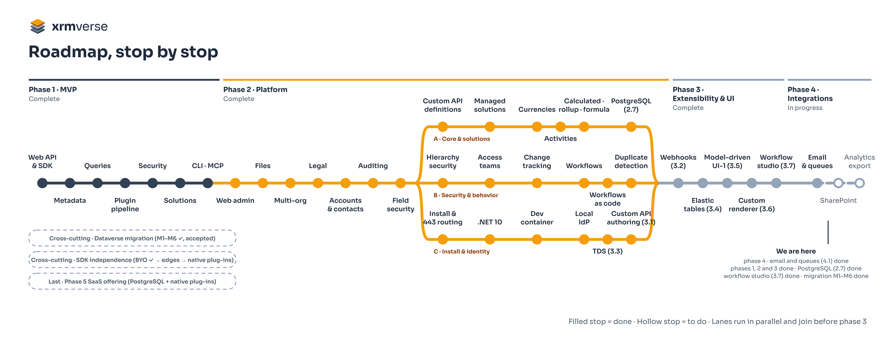

# xrmverse

> *Dataverse-compatible server, on your metal.*
>
> xrmverse is an independent project and is not affiliated with, endorsed by or sponsored by Microsoft. Microsoft, Dataverse, Dynamics 365 and Power Apps are trademarks of the Microsoft group of companies.

**Status as of November 22, 2026**: phases 1 (MVP), 2 (platform) and 3 (extensibility and UI) are complete, the last item of phase 2 being PostgreSQL organizations with every feature of SQL Server ones and the last item of phase 3 the workflow studio (3.7); phase 4 (integrations) is in progress; the migration from Dataverse is done (M1–M6) and accepted on a real Dataverse environment; releases are public (latest `v0.1.10`) under the Apache License 2.0.

This page is the entry point: what xrmverse is, why it exists and where it is going. Everything else is in the [documentation](#documentation), one page per topic.

To try it, start with [Getting started](docs/getting-started.md).

## What xrmverse is

xrmverse is a server that **speaks Microsoft Dataverse's language** and that you install **on your own servers**, instead of running in the Microsoft cloud.

To the tools you already use, it is Dataverse:
- code built on `ServiceClient` / `IOrganizationService` and on the Web API connects without changes;
- existing **.NET plugins** run in the same pipeline (PreValidation, PreOperation, PostOperation);
- `pac`, XrmToolBox and the Plugin Registration Tool connect as they would to a Dataverse environment;
- **solutions** import and export in the native format.

Underneath, though, are your SQL Server, your network and your rules.

The name comes from **xRM** ("anything Relationship Management"), the term the Dynamics community has long used for the platform behind the CRM, which lives on in `Microsoft.Xrm.Sdk` and in XrmToolBox. The server process and the CLI are called `xrmd`, "the Xrm daemon".

---

## Why xrmverse

| Benefit | Why it matters |
|---|---|
| **Data sovereignty** | Data stays in your data center: useful for banking, public sector, healthcare and other regulated environments. |
| **Works offline** | No mandatory cloud dependency, with the local IdP. |
| **No per-user or per-capacity licensing** | The cost is the infrastructure, not the number of users or GB. |
| **Reused skills** | Dataverse developers and consultants work with the same tools, the same SDK and the same solutions. |
| **Porting without rewriting** | Existing plugins, solutions and (in phase 3) Model-driven apps run without changes. |
| **Direct database access** | Backup, restore, monitoring and analysis handled by your DBA with familiar tools. |
| **Complete, cross-platform CLI** | Manage environments, tables, solutions and plugins from Windows, macOS and Linux. |
| **Schema as code** | `xrmd apply schema.yaml`: the schema versioned in Git and applied in CI. |
| **Workflows as code** | `xrmd workflow apply`: classic workflows, business rules and actions written as YAML, versioned in Git and compiled to the XAML the Dataverse classic designer uses. |
| **AI-native** | Built-in MCP server: agents work on data with the user's security. |
| **A UI without Power Apps' limits** | Themes, white-label, kanban, calendar, mobile layouts and wizards on top of the same customizations. |
| **Local dev environments** | A complete environment on a laptop in minutes, with no licensing cost. |
| **A foundation for SaaS** | The Dataverse model as the base for your own products, with no per-user cost. |

### When Dataverse is still the better choice

xrmverse does not replace Dataverse in every scenario. If you need Power Automate, canvas apps, Copilot in Power Apps or Power Pages, or if you do not want to run your own infrastructure (updates, high availability, security), Dataverse remains the simpler choice.

For a feature-by-feature view, see [xrmverse compared with Dataverse](docs/dataverse-comparison.md); open issues and current limitations are in [Known issues and limitations](docs/known-issues.md).

---

## Roadmap

*Vector version: [images/xrmverse-roadmap.svg](docs/images/xrmverse-roadmap.svg)*

| Phase | Scope | Status |
|---|---|---|
| **1 — MVP** | Web API, metadata, query, plugin pipeline, security, unmanaged solutions, `xrmd` CLI, Admin API, MCP | ✅ complete |
| **2 — Platform** | Web admin, file and image columns, several organizations on one SQL Server, auditing, field security (2.4), custom API definitions (import + execution; authoring is item 3.1, done in lane C), hierarchy security (2.5), access teams (2.16), change tracking (2.13), duplicate detection (2.15), managed solutions (2.6), currencies (2.10), local IdP (2.8), dev container (2.9), PostgreSQL; then activities and notes, calculated columns (2.12a ✅), rollup columns (2.12b ✅), formula columns (2.12c ✅), classic workflows | ✅ complete (in four lanes: **A** core and solutions, ending with PostgreSQL organizations, core 2.7a and the rest 2.7b; **B** security and behavior; **C** install and identity; **D** quality and backlog) |
| **Legal backlog** (plan 10) | Third-party notices and license check, SBOMs, vulnerability gate, `SECURITY.md`, SQL Server edition (Express by default), trademark notice, warning on Microsoft first-party solutions, About page | ✅ complete |
| **3 — Extensibility and UI** | Custom APIs (3.1 authoring ✅, pulled forward into lane C), webhooks (3.2 ✅, pulled forward into lane C; contract 8 only), TDS endpoint (3.3 ✅, pulled forward into phase 2, local IdP organizations only), elastic tables (3.4 ✅, pulled forward into lane D), model-driven UI-1 (3.5 ✅ complete, UI-1a to UI-1g: app picker, shell, site map, read-only views, forms and standard commands, web resources and the Client API, field and dataset PCF controls, custom commands, then dashboards and charts and the timeline for activities, notes and posts, pulled forward into lane C), visual workflow editor (3.7 ✅: the [workflow studio](docs/workflow-studio.md), a separate app with its own access, flow canvas plus a code view on the 2.21 YAML); Model-driven apps last (porting, then custom rendering) | ✅ complete (TDS endpoint, custom API authoring, elastic tables, webhooks, model-driven UI-1 (UI-1a to UI-1g), model-driven UI-2 (UI-2a to UI-2g), workflow studio (3.7)) |
| **4 — Integrations** | Email and queue sync, SharePoint, analytics export | 🔨 in progress (email and queues done) |
| **5 — SaaS offering** (last) | A hosted, resellable offering on PostgreSQL organizations with native plug-ins only (no Microsoft DLL): tenant isolation, provisioning and quotas, per-organization backup, metering and billing, service terms; after phase 4, S.2 and S.4 | ⏳ |
| **Migration from Dataverse** (cross-cutting) | One-off move of an application and its data with the same GUIDs: `xrmd migrate export`, encrypted package, server-side import with verification, `xrmd migrate run`, `activate` and MCP tools, accepted on a real Dataverse trial (M1–M6); see [Migrating from Dataverse](docs/migration.md) | ✅ M1–M6 (accepted on a Dataverse trial) |
| **SDK independence** (cross-cutting) | S.1 bring your own Microsoft SDK (`xrmd sdk install`, no Microsoft DLL in any artifact, see [Installing the Microsoft SDK](docs/microsoft-sdk.md)); S.2 then the SDK only at the edges, so that the Web API, web admin, MCP and CLI run with no Microsoft DLL; extensions without the SDK through webhooks and service endpoints; S.4 a native plug-in SDK of our own (`Xrmd.Plugins`, Apache 2.0) for in-process plug-ins with no Microsoft DLL, after S.2 | 🔄 S.1 ✅, webhooks ✅ |

---

## Documentation

The documentation is in English and lives in [`docs/`](docs/), one page per topic, written as a manual. Each page opens with an introduction, a comparison with Dataverse and a table of common tasks, then explains how to reach and use the feature, and ends with its known limits.

**Concepts**

| Page | What it covers |
|---|---|
| [Philosophy](docs/philosophy.md) | The contract with Dataverse, one semantics, self-sufficiency, AI agents, porting first |
| [Architecture](docs/architecture.md) | Modules, the path of a request, plug-ins, data and metadata, environments, identity, the UI |
| [xrmverse compared with Dataverse](docs/dataverse-comparison.md) | What is the same, what works differently, what is not in xrmverse |
| [Known issues and limitations](docs/known-issues.md) | Open issues, current limitations and the differences from Dataverse that stay, each with its outlook |

**Install and run**

| Page | What it covers |
|---|---|
| [Installing xrmverse](docs/install.md) | Production install from a release: requirements, host names on 443, certificates, your own reverse proxy, offline install, upgrade |
| [Getting started](docs/getting-started.md) | Quick start with Docker, the repository compose file, development tokens, notes (ServiceClient port, Apple Silicon) |
| [Deploy to Azure](docs/deploy-to-azure.md) | One-click ARM template for one VM from the xrmd image in a community Compute Gallery (preview) |
| [Installing the Microsoft SDK](docs/microsoft-sdk.md) | Bring your own SDK: `xrmd sdk install`, what needs it and what does not |
| [Configuration](docs/configuration.md) | Configuration keys and environment variables of `xrmd` |
| [Multiple organizations](docs/multiple-organizations.md) | Several organizations on one SQL Server: one database and one `xrmd` process each |
| [PostgreSQL organizations](docs/postgresql.md) | Organizations on PostgreSQL 16 or later: `server init --database postgresql`, your own server, backup and restore, text comparison and sorting, known limits |
| [SQL Server editions](docs/sql-server-editions.md) | Express by default, `MSSQL_PID`, licensing |
| [Observability](docs/observability.md) | Health checks, Prometheus metrics, OTLP tracing, `xrmd logs` |

**Platform reference**

| Page | What it covers |
|---|---|
| [Tables in every organization](docs/system-tables.md) | Seeded system tables, `account` and `contact`, relationships and cascades |
| [Supported queries](docs/queries.md) | FetchXML, QueryExpression and OData, limits and known deviations |
| [Calculated columns](docs/calculated-columns.md) | Definition paths, supported functions, limits, semantics, security, solution files, what is refused |
| [Formula columns](docs/formula-columns.md) | Power Fx formula columns: types, functions, blank values, dates, definition paths, limits, security, solution files, what is refused and what is not yet compared |
| [Rollup columns](docs/rollup-columns.md) | Types and aggregates, definition paths, filters and hierarchy, semantics, companions and states, the mass and incremental jobs, `CalculateRollupField`, security, solution files, what is refused |
| [Elastic tables](docs/elastic-tables.md) | Partitions, time to live, bulk messages, session token, what is refused and the known gaps |
| [Bulk operations](docs/bulk-operations.md) | `CreateMultiple`, `UpdateMultiple`, `UpsertMultiple`, `Upsert` and PATCH upsert on standard tables, the two-way plug-in merge, images, what is refused |
| [Migrating from Dataverse](docs/migration.md) | One-off migration of an application and its data into xrmverse: export, the encrypted package, import, verification, `xrmd migrate run`, `activate` and the MCP tools |
| [Email and queues](docs/email-and-queues.md) | Queues and queue items, mailboxes, outgoing and incoming email: the messages, default queues, privacy, security, sync and correlation, the `xrmd queue` and `xrmd mailbox` commands, contact center use, what is not yet verified |
| [Plug-ins](docs/plugins.md) | Registration, pipeline stages, messages, values the server sets, sandbox, trace, async queue, known limits |
| [Classic workflows](docs/workflows.md) | Workflows, business rules and XAML actions from solutions: triggers, stages and order with plug-ins, background jobs and waits, `ExecuteWorkflow`, custom workflow activities, the step catalog, known limits |
| [Workflow studio](docs/workflow-studio.md) | The visual editor at `/studio/workflows`: access by Process privileges, the list, flow canvas, properties panel, code view with live diagram, problems, save and activate, known limits |
| [Workflow authoring as code](docs/workflow-authoring.md) | Workflows, business rules and actions as YAML: the format, `xrmd workflow`, the authoring API and MCP tools, privileges, export, assumed shapes, known limits |
| [Webhooks](docs/webhooks.md) | Service endpoints of contract 8 and their steps: registering (CLI, Web API, SDK), the request sent, outcomes and retries, known limits |
| [Security](docs/security.md) | Roles, privileges and depth, business units, teams, sharing, hierarchy security, access teams |
| [Local identity provider](docs/local-idp.md) | Sign-in without Entra: `server init --auth local`, users and TOTP, service clients, ServiceClient connection strings, HTTPS and proxy, keys and backups, limits, no `pac` |
| [Auditing](docs/auditing.md) | The `audit` table, switches, audit messages, retention, known limits |
| [Field-level security](docs/field-security.md) | Secured columns, field security profiles, field sharing, known limits |
| [Custom APIs](docs/custom-apis.md) | Imported custom API definitions: tables, calling through the SDK, SOAP and the Web API, validation, the main operation, `$metadata`, solutions, known limits |
| [Solutions](docs/solutions.md) | Messages, managed solutions and layers (install, upgrade, uninstall), import and export, preserved XML, deleting a solution, size limits, known limits |
| [Files and images](docs/files-and-images.md) | File and image columns, blob stores, thumbnails, known differences |
| [Activities and notes](docs/activities.md) | Activities, `activitypointer`, party lists, notes and their attachments, custom activities, `SendEmail` without a provider, refused messages, known limits |
| [Currencies](docs/currencies.md) | Base currency, currencies and rates, `exchangerate` and `_base` columns, precision and formatting, `RetrieveExchangeRate`, known limits |
| [Glossary and synonyms](docs/glossary-and-synonyms.md) | The five knowledge source, synonym and glossary tables, creating rows over the Web API, what MCP returns, solutions, known limits |
| [Environment variables](docs/environment-variables.md) | Definition and value tables, write rules, import and export, `IEnvironmentVariableService` for plug-ins, `xrmd envvar`, known limits |
| [Duplicate detection](docs/duplicate-detection.md) | The three switches, rules and their conditions, publishing, the `SuppressDuplicateDetection` check and its `0x80040333` / 412 error, `RetrieveDuplicates`, `BulkDetectDuplicates`, known limits |
| [Change tracking](docs/change-tracking.md) | `ChangeTrackingEnabled`, `RetrieveEntityChanges`, Web API delta queries, the deletion log and its retention, known limits |
| [Autonumber columns](docs/autonumber-columns.md) | `AutoNumberFormat`, generated values on Create, sequences, seed messages |
| [SQL endpoint](docs/sql-endpoint.md) | Read-only SQL for SSMS, Power BI and SqlClient: SQL logins of the local identity provider, `--tds-port`, TLS and the certificate sync, the supported SQL and its errors, columns, limits, security, no Entra yet |

**Tools**

| Page | What it covers |
|---|---|
| [CLI `xrmd`](docs/cli.md) | Install, command groups, server setup, profiles, exit codes, backups, publishers and the prefix rule, schema files, every command group |
| [Skills for coding agents](docs/agent-skills.md) | The seven agent skills that teach Claude to use `xrmd`: installing them as a Claude Code plugin, what each covers, the rules they keep |
| [Admin API](docs/admin-api.md) | The `/admin` endpoints used by the CLI and the web admin |
| [Web admin](docs/web-admin.md) | The `/manage` UI: who can use it, sections, sign-in, look and feel, the view and form designers, deleting a solution, development loop |
| [Model-driven apps](docs/model-driven-apps.md) | The app picker (`/apps`), site map, views, forms, commands, web resources and form scripts, PCF controls, dashboards, timeline, classic and modern looks, known limits |
| [MCP](docs/mcp.md) | The built-in MCP server for AI agents: connecting a client, the tools, knowledge for agents, workflow and migration tools |

**Project**

| Page | What it covers |
|---|---|
| [Development](docs/development.md) | Building and testing the repository, acceptance tests |

## License

xrmverse is licensed under the [Apache License, Version 2.0](LICENSE). Copyright 2026 Power Builders Italia S.r.l.; see [NOTICE](NOTICE).
The names "xrmverse" and "xrmd" and the logos are trademarks of Power Builders Italia S.r.l. and are not covered by the license: see [Trademarks](TRADEMARKS.md).
Contributions are welcome under the same license, with a DCO sign-off: see [Contributing](CONTRIBUTING.md).

## Legal

- xrmverse is an independent project; see the trademark notice at the top of this page.
- Microsoft first-party solutions are not supported: they depend on components xrmverse does not have. Importing one is not blocked but logs a warning; see [Solutions](docs/solutions.md).
- The Microsoft SDK is not shipped with xrmverse: you install it yourself, see [Installing the Microsoft SDK](docs/microsoft-sdk.md).
- SQL Server runs as the Express edition by default; the Developer edition is not licensed for production. See [SQL Server editions](docs/sql-server-editions.md).
- [License](LICENSE) · [Notice](NOTICE) · [Trademarks](TRADEMARKS.md) · [Third-party notices](THIRD_PARTY_NOTICES.md) · [Security policy](SECURITY.md).

---

## Repository layout

| Folder | Content |
|---|---|
| `src/Xrmd.Host` | The `xrmd` server process (ASP.NET Core) |
| `src/Xrmd.Core`, `Xrmd.Abstractions` | The internal `IOrganizationService` and shared contracts |
| `src/Xrmd.WebApi` | OData v4 Web API and the minimal SOAP endpoint |
| `src/Xrmd.Metadata` | Metadata model and cache, SQL DDL generation |
| `src/Xrmd.Schema` | Schema as code: YAML export, diff and apply |
| `src/Xrmd.Query` | FetchXML, QueryExpression and OData compiled to T-SQL |
| `src/Xrmd.Pipeline` | Plug-in pipeline and async queue |
| `src/Xrmd.Security` | Roles, privileges, business units, teams, sharing, field security |
| `src/Xrmd.Solution` | Solution import and export |
| `src/Xrmd.Files` | File and image columns, blob stores |
| `src/Xrmd.Audit` | Auditing |
| `src/Xrmd.Admin`, `Xrmd.Mcp` | Admin API and MCP server |
| `src/Xrmd.Cli` | The `xrmd` CLI |
| `ui` | Web admin (React, Fluent UI v9) |
| `tests` | Unit, integration (Testcontainers) and acceptance tests |
| `fixtures` | Seed data and test fixtures, with their origin in [`fixtures/README.md`](fixtures/README.md) |
| `docker` | Dockerfile and the repository compose file |
| `eng`, `tools` | License checks, SBOMs and notices, the check that no Microsoft SDK DLL ships |
| `packaging` | Homebrew formula |
| `site` | The public website generator for GitHub Pages |
| `docs` | Topic documentation and images |

## Keeping the documentation aligned

The documentation is part of the product. Every pull request that changes a behaviour (an endpoint, a message, a command, a configuration key, a limit or a deviation from Dataverse) updates the topic page that describes it in the same pull request. A pull request that adds, changes, fixes or removes a known issue, a limitation or a difference from Dataverse also updates [Known issues and limitations](docs/known-issues.md) (the entry, its outlook and the date at the top). When a roadmap item is completed, the pull request also updates the [Roadmap](#roadmap) table and the roadmap image (`docs/images/xrmverse-roadmap.svg`, with the `.png` regenerated from it). The short status summary at the top of this page changes only when a phase or lane changes state; items are never listed there. When a page is added or renamed, update the [Documentation](#documentation) table.
