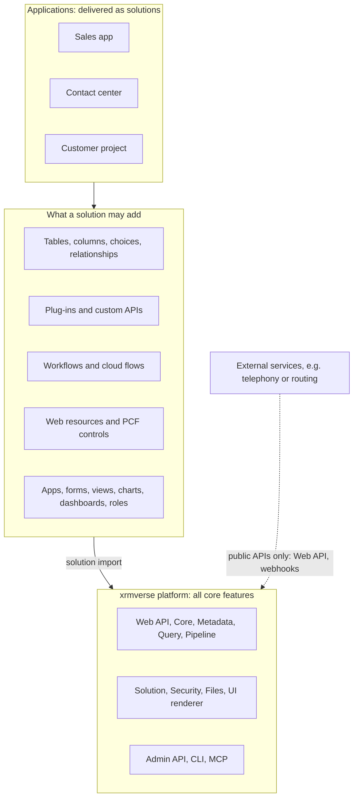
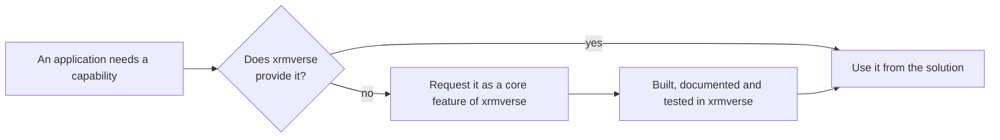
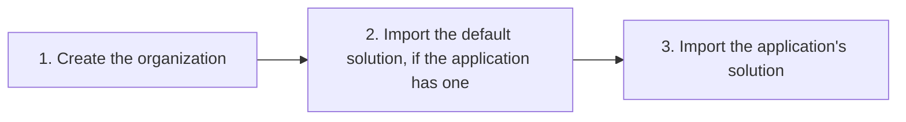
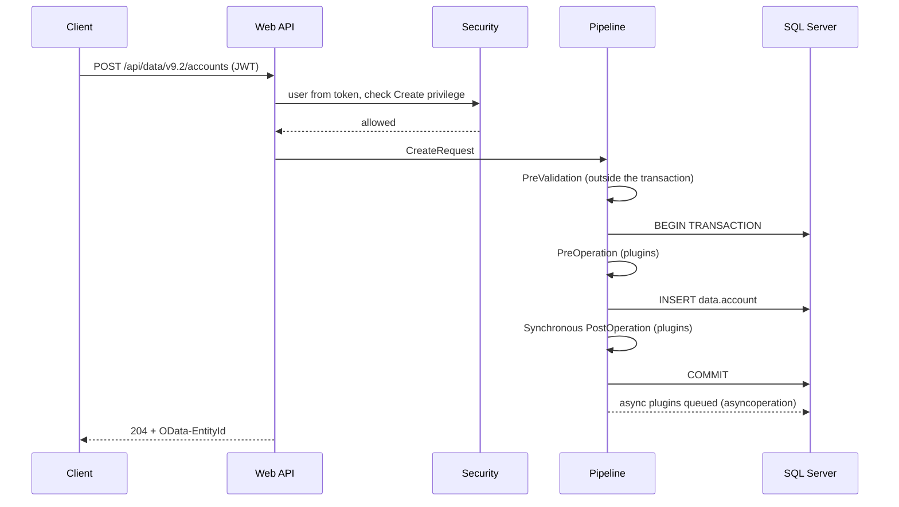
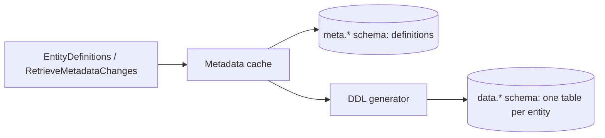
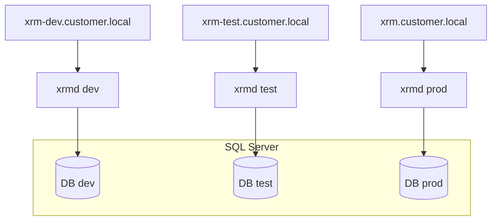
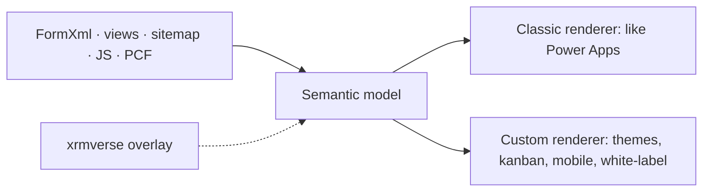

# Architecture

[← xrmverse documentation](../README.md#documentation)

## Introduction

This page describes how xrmverse is built inside: its modules, the path a request takes, where data and metadata live, how
environments are deployed and how the UI is rendered. You do not need it to use xrmverse, but it explains why the server
behaves as it does.

| Topic | In one line |
|---|---|
| [Overview](#overview) | A modular monolith: one process, clear module boundaries |
| [Platform and applications](#platform-and-applications) | Core features live in xrmverse; applications extend it only through solutions |
| [Modules](#modules) | Web API, Core, Metadata, Query, Pipeline, Solution, Files, Security, Admin API/CLI/MCP |
| [The path of a request](#the-path-of-a-request) | Security, then the pipeline stages in one transaction |
| [Plugins](#plugins) | Same context as Dataverse, isolated per assembly |
| [Data and metadata](#data-and-metadata) | One real SQL table per Dataverse table |
| [Environments and deployment](#environments-and-deployment) | One environment = one organization = one database = one process |
| [Identity](#identity) | Entra ID or a local identity provider |
| [The UI (phase 3)](#the-ui-phase-3) | A renderer that interprets the same XML as Power Apps |

### Compared with Dataverse

| Area | xrmverse | Compared with Dataverse |
|---|---|---|
| Hosting | One process per environment, on your servers | **Differs**: Dataverse is a multi-tenant Microsoft cloud service |
| Database | SQL Server with direct access; one database per organization | **Differs**: managed Azure SQL, no direct access |
| Stages and transaction | Stages 20, 30 and 40 share one transaction | Same |
| UI | xrmverse's own renderer of the same customizations | **Differs**: faithful for the supported Client API, not pixel-identical |

## Overview

*Vector version: [images/xrmverse-architecture.svg](images/xrmverse-architecture.svg)*

It is a **modular monolith**: a single process, with modules that have clear boundaries and talk to each other only through interfaces. It is simple to install and debug, and modules can be split out later if needed.

## Modules

| Module | Responsibility |
|---|---|
| **Web API** | OData v4 adapter to the Core: CRUD, `$metadata`, `EntityDefinitions`, actions and functions, annotations (lookups, FormattedValue, etag). No business logic. |
| **Core** | Internal `IOrganizationService`: the single entry point for every operation. |
| **Metadata** | A model identical to the SDK classes (`EntityMetadata`, `AttributeMetadata`…), a cache with version stamps, SQL DDL generation. |
| **Query** | FetchXML, OData and QueryExpression translated into a single AST, then compiled to T-SQL with paging, aggregates and security predicates. |
| **Pipeline** | Runs plugins in Dataverse's stages, in an isolated sandbox, with an async queue. |
| **Solution** | Import/export of the native `solution.zip` format, component apply order, `importjob` log. |
| **Files** | File and image columns: the blob store (file system, S3-compatible or Azure Blob) behind `IFileStore`, upload and download sessions, thumbnails, the cleanup sweep. |
| **Security** | Roles, privileges with depth, business units, teams, sharing. |
| **Admin API, CLI, MCP** | Environment management, diagnostics, access for AI agents. |

## Platform and applications

xrmverse is the **platform**: every core feature lives in xrmverse itself. An **application** built on it (a sales app, a
contact center, a customer project) is delivered as one or more **solutions** and extends the platform only through the
components a solution carries. An application never changes the platform: no patch to the server, its modules, its
database schema or its UI renderer.

| Rule | What it means |
|---|---|
| Core in the platform | A capability that is general (queues, email, side panes, solution tooling, plug-in SDK…) is built in xrmverse, documented and tested there, available to every application. |
| Applications are solutions | An application ships tables, columns, plug-ins, workflows and flows, web resources, PCF controls, apps, forms, views and roles, and nothing else inside the platform. |
| No changes to the platform | An application does not patch, fork or reconfigure the server, its database or its UI renderer, and does not depend on internals that are not part of the public surface. |
| A missing capability goes to the platform | When an application needs something xrmverse cannot do, the capability is added to xrmverse as a core feature (a roadmap item), then the application uses it. No workaround inside the application. |
| Services stay outside | An application may run its own services next to xrmverse; they are clients and talk to it only through the public APIs (Web API, webhooks). |

### Deployment lifecycle of an application

Every application is installed the same way, on any organization (dev, test, production):

1. **Create the organization**: `xrmd server init --org <name>` or `xrmd server org add <name>` (see [CLI](cli.md)). It
   starts with the platform only.
2. **Import the default solution, if there is one**: the shared base that the application's solution depends on.
3. **Import the specific solution** of the application (`xrmd solution import`), then run its setup step if it has one.

Nothing is customized by hand in between: every change reaches an organization through a solution.

## The path of a request

Stages 20, 30 and 40 share the same transaction: if a plugin throws, everything rolls back, just as in Dataverse.

## Plugins

- A plugin receives the same context as in Dataverse: `InputParameters`, pre/post images, `Depth`, `SharedVariables`, `IOrganizationServiceFactory`, `ITracingService`.
- Each assembly runs in an isolated `AssemblyLoadContext`; `Microsoft.Xrm.Sdk` is shared with the host so that types match. .NET plug-ins therefore need the Microsoft SDK, which you install yourself (see [Installing the Microsoft SDK](microsoft-sdk.md)).
- Registration uses the standard tables (`pluginassembly`, `plugintype`, `sdkmessageprocessingstep`…): the Plugin Registration Tool and solution import work with no special API.

## Data and metadata

Every Dataverse table becomes a real SQL table in `data.*`, with faithfully mapped types: polymorphic lookups, money with its base value, UTC dates with their behaviour, `versionnumber` as rowversion.

## Environments and deployment

**1 environment = 1 organization = 1 database = 1 `xrmd` process.** Several environments (dev, test, prod) are several `xrmd` containers that can share the same SQL Server instance, each with its own database. `xrmd server init --org dev --org test --org prod` generates exactly this layout; see [Multiple organizations](multiple-organizations.md).

The reference deployment is `docker compose`. As a regular .NET 10 application, it can also run as a Windows service, under IIS or as a systemd service, and it can use a SQL Server the company already runs.

## Identity

JWT authentication: **Entra ID** as the main mode, a **local identity provider** (phase 2) for environments with no connectivity to the cloud. Either way, the token's user maps to a `systemuser`, and security is Dataverse's.

## The UI (phase 3)

The Power Apps UI is a closed Microsoft service and cannot be pointed at your own server. So xrmverse builds a **renderer** that interprets the same XML found in solutions:

- **UI-1, porting**: existing Model-driven apps run with their forms, views, JavaScript (supported Client API) and PCF controls.
- **UI-2, custom rendering**: a completely different look, chosen per environment, app or user, without touching the original customizations. The renderer travels in solutions like any other component.

See [Model-driven apps](model-driven-apps.md).

## See also

- [Philosophy](philosophy.md)
- [Solutions](solutions.md), [Plug-ins](plugins.md), [Model-driven apps](model-driven-apps.md): the components an application ships
- [Plug-ins](plugins.md), [Supported queries](queries.md), [Security](security.md), [Solutions](solutions.md)
- [Multiple organizations](multiple-organizations.md), [Local identity provider](local-idp.md)
