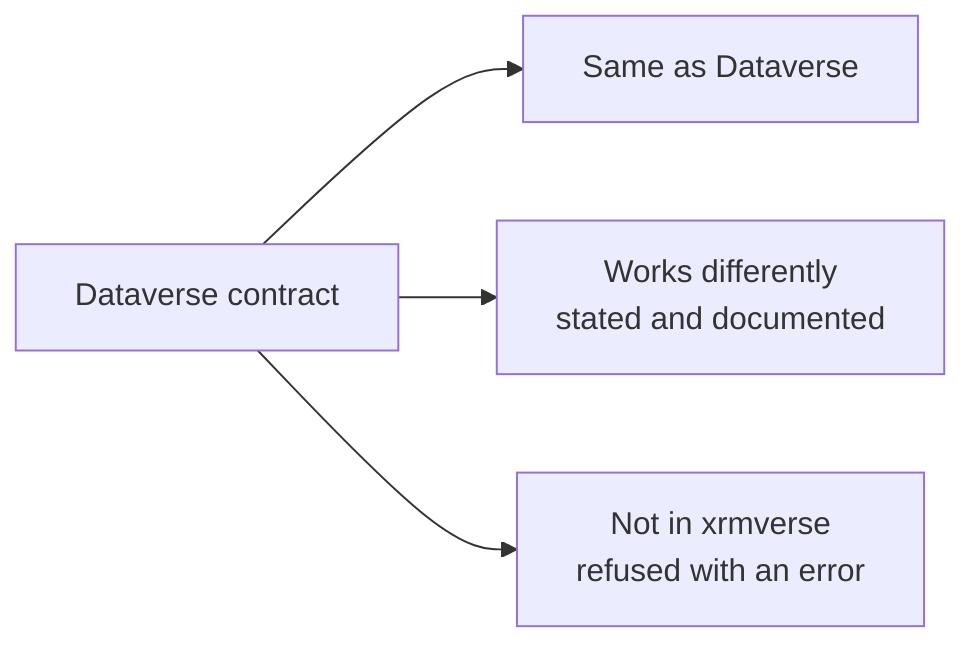

# xrmverse compared with Dataverse

[← xrmverse documentation](../README.md#documentation)

## Introduction

This page is the one-page summary of how xrmverse relates to Dataverse: what behaves the same, what works differently and
what is not offered at all. Each feature page of this manual has its own "Compared with Dataverse" table with the details;
this page collects the headlines.

The comparison refers to the product **once the roadmap is complete** (phases 1–4). What is missing or wrong in the current
version, and whether it will change, is in [Known issues and limitations](known-issues.md).

Nothing falls between these three groups: what xrmverse cannot reproduce faithfully is refused with an explicit error or
stated on the feature's page, never silently run differently (see [Philosophy](philosophy.md)).

## Same as Dataverse

| Area | Features |
|---|---|
| APIs | Web API and SDK, metadata, FetchXML and OData |
| Business logic | Plug-ins and pipeline, classic workflows, Custom APIs, webhooks |
| Security | Roles, business units, teams, sharing, field and hierarchy security, access teams |
| Application lifecycle | Managed and unmanaged solutions |
| Data features | Auditing; file, image, calculated, rollup and formula columns; currencies; activities and notes; duplicate detection; change tracking |
| Access | A read-only SQL (TDS) endpoint (with the differences below) |
| User interface | Existing model-driven apps |

## Works differently

Each table lists the aspect, what Dataverse does and what xrmverse does.

### Platform and operations

| Aspect | Dataverse | xrmverse |
|---|---|---|
| Where it runs | Microsoft cloud, multi-tenant | Your servers or your cloud, one process per environment |
| Database | Managed Azure SQL, no direct access | SQL Server or PostgreSQL 16 or later, one engine per server, direct access. PostgreSQL organizations have every feature of SQL Server ones; text sorts and compares as on SQL Server except for the order of punctuation and `like` with full-width, kana or `ß`, and a `like` pattern with a character range is refused (see [PostgreSQL organizations](postgresql.md)) |
| Identity | Entra ID only | Entra ID or the server's own identity provider (see [Local identity provider](local-idp.md)) |
| Power Platform CLI (`pac`) | Signs in with Entra | Works with Entra mode; **not supported with the local IdP** (it hard-codes Microsoft's authorities): use `xrmd solution import/export` |
| Scalability and high availability | Managed by Microsoft | Depend on your infrastructure |
| Files | Managed Azure Blob | File system, S3-compatible storage or Azure Blob Storage you manage (see [Files and images](files-and-images.md)) |
| Updates, support, compliance | Microsoft | Whoever runs the installation |

### Data and queries

| Aspect | Dataverse | xrmverse |
|---|---|---|
| Bulk messages | `CreateMultiple` / `UpdateMultiple` are events on standard tables, `Upsert` / `UpsertMultiple` are not; all-or-nothing on standard tables, partial success on elastic ones; the pipelines of single and bulk messages merge | Same model on standard tables (more tables than Dataverse offers them on); inner execution depth, step order and rank ties are our reading of the docs; steps on `*Multiple` of an elastic table are refused; `Upsert` and PATCH as upsert on standard tables; asynchronous payloads and image reads grow with the bulk (see [Bulk operations](bulk-operations.md)) |
| Web API `$batch` | Up to 1000 requests; change sets are atomic | Same. A change set refuses what commits in a transaction of its own (metadata, file columns, solution, audit and autonumber messages, elastic tables) instead of running it outside the transaction (see [Bulk operations](bulk-operations.md#web-api-batch)) |
| Elastic tables | Cosmos DB | Emulated on SQL: ids stay unique across partitions, writes commit per stage (nested ones join the outer transaction), bulk messages run one pipeline per record with partial success, basic JSON queries with `ExecuteCosmosSqlQuery`, no solution export yet (see [Elastic tables](elastic-tables.md)) |
| Change tracking | `audit` is tracked | `audit`, intersect tables and some system tables cannot be tracked; paging cookie and skip token are xrmverse's own (see [Change tracking](change-tracking.md)) |
| Currencies | Names and symbols of System currencies are filled in; precision up to 10 in the column; per-user number formats | Name and symbol are required; precision 0 to 4; en-US formatting only; the ISO list and a few error codes are xrmverse's own reading (see [Currencies](currencies.md#known-limits)) |
| Activities and notes | Sends email through a mailbox; queues, recurring appointments and email attachments; chunked note attachments | `SendEmail` sends through the sender's mailbox over SMTP or Microsoft Graph, from the caller or a queue the caller can read; mailboxes receive over IMAP or Microsoft Graph, with filtering, duplicate keys, parties from four tables and correlation without smart matching (see [Incoming email](email-and-queues.md#incoming-email)); a mailbox that cannot send fails the email; tracking tokens are off by default; email attachments in the file store; queues (see [Email and queues](email-and-queues.md)); `activitypointer` is a stored copy; recurrence and templates are refused; note bodies in one piece, up to 128 MB; `post` and `postcomment` cannot be updated, auto posts are refused, and reading or deleting a post needs read on its record (our call) (see [Activities and notes](activities.md#known-limits)) |
| Calculated columns | Learn documents defining them in the maker portal; sorting is disabled for columns that read a parent, a chain or the current time; the XAML and its file names are Microsoft's | Also created by `CreateAttribute`/`UpdateAttribute` (SDK and Web API), by `xrmd schema` (`calculated:`) and by solution import; computed in SQL at read time (chain of 5, 50 per query, parent through one lookup); sorting always works; writes are ignored; no audit entries; a value that does not fit or a division by zero is null; dates computed in UTC (assumed); a calculated primary name column is refused; the XAML shapes are our reading; the `/Formulas/` file names are confirmed by the 2.12a parity export (see [Solutions](solutions.md) and [Calculated columns](calculated-columns.md)) |
| Formula columns | Power Fx, defined in the maker portal or over the Web API (the formula in the caller's language, without a leading `=`); Choice results (never Currency); error values (`IfError`, `IsError`); sorting not available for some formulas | Also created by `CreateAttribute`/`UpdateAttribute` (SDK and Web API), by `xrmd schema` (`formula:`) and by solution import (the per-table YAML file, confirmed); checked with the open-source Power Fx library and computed in SQL at read time (chain of 10 with calculated columns, one related level); Choice formula columns, the error functions and `StartOfWeek` are refused; a division by zero or an out-of-range result is an error that propagates and shows as an empty value (confirmed for arithmetic), but cannot be tested; the formula is read in the invariant form only (`,` separators; a `;` is refused with a hint), whatever the caller's language; a failed formula column read by another formula is a blank there, and `Max`/`Min` leave blank arguments out (confirmed); a leading `=` is refused as on Dataverse; a related column is named by the lookup's navigation property (confirmed); Whole number results are truncated; text compares with the database collation (case-insensitive by default); `Value` reads plain decimals only; `DateAdd` truncates a fractional count; date parts only on Date only dates; `Max`/`Min` need SQL Server 2022; sorting always works; writes are ignored; no audit entries; they cannot be secured (as in Dataverse), and the sources' field security does not hide the value (not yet compared); apart from three formulas of a parity export and eleven of a run on a licensed environment (2026-11-19), the values are not yet compared with Dataverse (see [Formula columns](formula-columns.md)) |
| Rollup columns | Defined in the maker portal; a Mass Calculate Rollup Field job per column and an incremental Calculate Rollup Field job per table, which can be postponed, paused, resumed and re-scheduled; jobs linked to `rollupfield` rows; limits of 50 per table and 200 per organization (10 and 100 on the developer page) | Also defined by `CreateAttribute`/`UpdateAttribute` (SDK and Web API), `xrmd schema` (`rollup:`) and solution import; the same two jobs and `CalculateRollupField`, computed in SQL as the system; the incremental job recalculates every rollup whose mass job has run and writes the rows that change or were touched since its last run; a hierarchy rollup includes the row itself; jobs walk 100 levels (state 5 deeper, 6 on a loop), online calculation 50,000 rows and 10 levels; compared with a licensed environment (empty sets state 1, `AVG` counts empty values as 0, Currency converted per row); Currency rollups keep four decimals and write a `_base` of 0 on an empty set; Decimal values truncated before aggregating (assumed); jobs can be postponed and their recurrence changed (1 hour to 365 days, the upper bound ours) but not paused, resumed, cancelled or deleted; `rollupfield` is not modelled and `regardingobjectid` stays empty; never audited (see [Rollup columns](rollup-columns.md)) |
| Duplicate detection | Rules are solution components; default rules for some tables; operator "Exact Match (Pick List Label)"; email and recurring bulk jobs; `Compound*` messages; matchcode length limit | Rules are not carried by solutions; no default rules; operator 5 is refused; no email, no recurrence, bulk jobs stop at 5000 `duplicaterecord` rows; no `Compound*` messages; match codes are SHA-256 hashes; the import and offline switches are stored and do nothing (see [Duplicate detection](duplicate-detection.md)) |
| Glossary and synonyms | Knowledge source, synonym and glossary tables, used by agents built in Copilot Studio, which need Dataverse search to be on (see [Learn](https://learn.microsoft.com/power-apps/developer/data-platform/reference/entities/dvtablesearch)); in solutions | The same five tables with the Dataverse names and lookups, read by [MCP](mcp.md#knowledge-for-agents) only. Columns left out: `appid`, `appmoduleid`, `appmoduleuniquename`, `apptype`, `connectionreference`, `knowledgeconfig`, `knowledgesourceconsumerid`, `knowledgesourceprofileid`, `m365appmoduleid`, `m365appmoduleidsecondary`, `entity`, `unstructuredfilesearchentityid`, `attribute`, `isattributeenabledforvectorsearch`; object type codes are xrmverse's own; not solution components, an import logs a warning (see [Glossary and synonyms](glossary-and-synonyms.md)) |
| SQL deadlock and timeout | A deadlock victim or a SQL timeout comes back as the SQL error codes `0x80044150` and `0x80044151` ([web service error codes](https://learn.microsoft.com/power-apps/developer/data-platform/reference/web-service-error-codes)) | Same codes, HTTP 500, on the Web API, the SOAP endpoint and inside a plug-in's organization service call (the plug-in gets a `FaultException<OrganizationServiceFault>`, and the transaction is doomed as for any failed nested call). The server never retries by itself: the request was rolled back and pre-validation plug-ins have already run outside the transaction, so a retry would run them twice. The caller retries |

### Processes and extensions

| Aspect | Dataverse | xrmverse |
|---|---|---|
| Classic workflows | Authored in the designer; XAML run by Windows Workflow Foundation; workflow log; Form-scope business rules; XAML actions on the Web API; custom activities on .NET Framework in a sandbox | Imported by solution, or written as YAML with `xrmd workflow apply` (see [Workflow authoring as code](workflow-authoring.md)); XAML read by xrmverse's own interpreter, which runs the designer's steps and fails explicitly on anything else; no `workflowlog`, only the job row; Entity-scope business rules only; XAML actions through the SDK and SOAP only; no Pause/Resume; custom activities run on .NET through CoreWF with the workflow SDK you install, in the server process (see [Classic workflows](workflows.md#known-limits)) |
| Custom API authoring | Created in the maker portal, the Plug-in Registration Tool, or by solution; a customizable managed API can be changed; deep insert of the fields | Created over the SDK, SOAP, the Web API or `xrmd customapi create`, one Create per API, parameter and property; no deep insert; no `iscustomizable` column; a managed API is never changed in place; Delete is refused while a step is registered; the prefix may be that of any existing publisher; the rules follow Learn and are not verified against Dataverse (see [Custom APIs](custom-apis.md#authoring)) |
| xrmverse-only: sender policy `xrmverse_EmailSendFrom` | None | An environment setting that allows outgoing email from queues only (`queueOnly`) or from users and queues (`userOrQueue`, the default, as Dataverse); Dataverse has no such switch (see [Email and queues](email-and-queues.md#sender-policy-xrmverse_emailsendfrom)) |
| xrmverse-only: shared variable `xrmverse_MailboxDeliveryId` | None | The plug-in contexts of an incoming email delivery (the email and attachment Creates, `AddToQueue` and its nested `queueitem` Create) carry the mailbox id in `SharedVariables`, so a guard can tell a delivery from any other caller; no caller can set it, and a plug-in that changes it fails the message. Dataverse has no such variable: a guard that relies on it needs another rule there (see [Building a delivery guard](email-and-queues.md#building-a-delivery-guard)) |
| xrmverse-only: note for attachments not imported | Not verified | A blocked or oversized attachment of an incoming message is not stored; a note on the received email, written by xrmverse, names each such file and why (see [The received email](email-and-queues.md#the-received-email)) |
| Webhooks | Webhooks and Azure Service Bus and Event Hub endpoints, in solutions; the auth value is encrypted; `x-ms-dynamics-organization` is the domain name | Webhooks only (contract 8), registered per organization, never in a solution; the auth value is stored unencrypted in the organization database and never returned; the header carries the organization name; a failed delivery is 500 `0x80040224`, and async jobs retry with the queue's backoff (see [Webhooks](webhooks.md#known-limits)) |

### User interface

| Aspect | Dataverse | xrmverse |
|---|---|---|
| UI | Microsoft's Unified Interface | xrmverse renderer: faithful for the supported Client API, not pixel-identical |
| Timeline | Activities, notes and posts of a record, with the settings of the form designer (record types, card forms, rollup, pin, email reply) | Activities and notes, and posts with @mentions of users when an app turns on `xrmverse_TimelinePosts` (off by default, in place of Post Configurations), with Learn's default settings: the timeline's FormXml settings are not read, and a notice says so. No rollup, pin, card forms or email reply; no auto posts, likes, follows, attachments on posts, `#` record references, personal wall or rich text posts; xrmverse's own look, with optional date groups and remembered filters (see [Model-driven apps](model-driven-apps.md#known-limits-of-the-timeline-ui-1g)) |
| xrmverse-only: `XrmVerse` namespace and app OnLoad | None | App side panes and app notifications through `XrmVerse.App`, an app OnLoad event from the `xrmverse_AppOnLoad` app setting, and a collapsible navigation in both looks; side panes show web resources only; a solution that uses them does not import into Dataverse (see [Model-driven apps](model-driven-apps.md#xrmverse-extensions)) |

### SQL endpoint

| Aspect | Dataverse | xrmverse |
|---|---|---|
| SQL endpoint: sign-in | Microsoft Entra only | **Local identity provider only, with a SQL login (user name and password)**: the opposite. Entra organizations have no SQL endpoint for now; a token login is refused with error 18456. Users with TOTP are refused, a disabled user or a user without roles cannot connect, and lockout is shared with web sign-in (see [SQL endpoint](sql-endpoint.md#who-can-connect)). SSMS "Microsoft Entra MFA" and the Power BI Dataverse connector, which sign in with Entra, are expected not to work: a token login that reaches the endpoint is refused with 18456 (not yet verified with these clients); use the Power BI SQL Server connector |
| SQL endpoint: SQL | A read-only T-SQL subset (see Microsoft's documentation for its limits) | The subset the query engine can express: `SELECT` with `TOP`, `DISTINCT`, `INNER`/`LEFT JOIN` on a lookup, `WHERE`, `ORDER BY`, `GROUP BY` with the aggregates, `sp_executesql`. No subqueries, `UNION`, `HAVING`, `OFFSET`, scalar functions in the select list, `CAST`, `CASE`, `APPLY`; anything else is refused with error 40000. `SET` options are ignored (`SET FMTONLY ON` is refused) and `sys.*` views are not available |
| SQL endpoint: columns | Lookup, choice and similar columns with their name and label companions; file, image, multiselect choice, party list and virtual columns are refused | Same shape: the id or integer, plus `<column>name` for the name or label. File, image, multiple-choice, party list and virtual columns give `Invalid column name`. `*` leaves out secured columns the user cannot read |
| SQL endpoint: size and port | 5 minute limit; port 1433 or 5558 | Results are buffered: at most 50000 rows by default (`Tds:MaxRows`), never partial, 5 minute limit. One port per organization, which you choose (`--tds-port`). TLS is required (`Encrypt=True`); `Encrypt=Strict` (TDS 8) is not supported |
| SQL endpoint: plug-ins | Reads do not trigger plug-ins | Same: no plug-in runs on SQL reads |

## Not in xrmverse

These Dataverse and Power Platform features are not offered:

| Area | Not offered |
|---|---|
| Automation | Power Automate and the Dataverse connector |
| Apps | Canvas apps and custom pages, Business Process Flows, editable grids, the offline mobile app, Power Pages |
| AI | Copilot and AI Builder in Power Apps |
| Data | Virtual tables, Dataverse search (relevance search, vector search) |
| Platform | Multiple organizations in one process, position hierarchy |

## See also

- [Known issues and limitations](known-issues.md): the current state, item by item
- [Philosophy](philosophy.md): why xrmverse fails visibly instead of diverging silently
