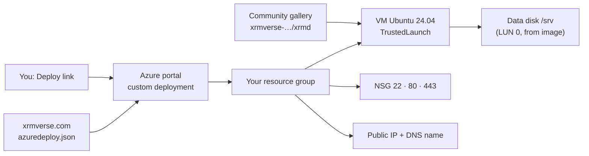
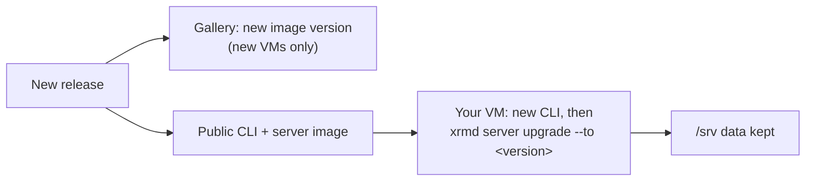

# Deploy to Azure

[← xrmverse documentation](../README.md#documentation)

> **Preview.** xrmverse server is a pre-release, licensed under the
> [Apache License 2.0](../LICENSE); support and downloads are covered by the [Terms of Use](https://xrmverse.com/terms/).

## Introduction

Deploy to Azure creates a ready-to-configure xrmverse server in your own Azure subscription with one click: an ARM template
that creates one Linux virtual machine from the xrmd image. The image is published in a **community Compute Gallery**.

Unlike Dataverse, which is a service Microsoft runs for you, the VM is yours: you choose its size, pay Microsoft for the
Azure resources, and maintain the operating system and xrmverse.

| Step | Where | See |
|---|---|---|
| 1. Create the VM | Azure portal or Azure CLI | [Deploying](#deploying) |
| 2. Configure xrmverse | SSH session on the VM | [After the deployment](#after-the-deployment) |
| 3. Keep it up to date | SSH or Azure Run Command | [Upgrading a deployed VM](#upgrading-a-deployed-vm) |

### Before you start

- An Azure subscription where you can create resource groups.
- An SSH key pair, and the public IP address you will connect from.
- A resource group in **West Europe**: the image is published there only.

## Deploying

### From the Azure portal

**[Deploy xrmverse server to Azure](https://portal.azure.com/#create/Microsoft.Template/uri/https%3A%2F%2Fxrmverse.com%2Fdeploy%2Fazure%2Fazuredeploy.json)**

The link opens the Azure portal's custom deployment page with the template
`https://xrmverse.com/deploy/azure/azuredeploy.json`. You review every parameter and the portal shows the cost of the VM
before you create it. You pay Microsoft for the Azure resources; xrmverse is free software under the
[Apache License 2.0](../LICENSE).



## What the template creates

| Resource | Details |
|---|---|
| Virtual machine | `Standard_D2s_v5` by default (D4s_v5, D8s_v5 allowed), Trusted launch, SSH key only, boot diagnostics |
| OS disk | 30 GB Premium SSD from the image, deleted with the VM |
| Data disk | LUN 0 from the image, mounted at `/srv`, 64 GB or more; detached (kept) when the VM is deleted |
| Network | Virtual network `10.42.0.0/24`, network security group with SSH (from the address you give) and 80/443 |
| Public IP | Static, Standard SKU, with a DNS name `<vmName>-<hash>.<region>.cloudapp.azure.com` |

### Parameters

| Parameter | Meaning |
|---|---|
| `vmName` | Name of the VM, also the start of its DNS name |
| `vmSize` | `Standard_D2s_v5` (default), `Standard_D4s_v5` or `Standard_D8s_v5` |
| `adminUsername` | The SSH user |
| `sshPublicKey` | Your public SSH key |
| `sshSourceAddressPrefix` | **Required**: the address allowed on SSH, your IP as `x.x.x.x/32` |
| `webSourceAddressPrefix` | The addresses allowed on 80 and 443 |
| `dataDiskSizeGB` | Size of the data disk, 64 GB or more |
| `imageId` | The gallery image |
| `location` | The region; the image is in West Europe only |

### From the command line

```bash
az group create -n rg-xrmd -l westeurope
az deployment group create -g rg-xrmd \
  --template-uri https://xrmverse.com/deploy/azure/azuredeploy.json \
  --parameters sshPublicKey="$(cat ~/.ssh/id_ed25519.pub)" sshSourceAddressPrefix="$(curl -s https://ifconfig.me)/32"
```

## After the deployment

1. The deployment outputs give the host name and the SSH command.
2. Sign in and follow `/etc/xrmd/README`.
3. Continue with [Installing xrmverse](install.md) from `xrmd server init`.

The image holds neither the Microsoft SDK nor the SQL Server image: you download them and accept their licences yourself at
init (`--accept-microsoft-license`, `--accept-sql-server-eula`; see [Installing the Microsoft SDK](microsoft-sdk.md) and
[SQL Server editions](sql-server-editions.md)).

## Upgrading a deployed VM

A new image version only changes the VMs created after it: a VM you already deployed is upgraded in place, and its
data on `/srv` stays.



### 1. Upgrade xrmverse

Back up, install the CLI of the new version, then upgrade the server to the same version (the CLI
and the server always have the same version). From an SSH session on the VM:

```bash
V=0.1.11   # the new version
U=https://github.com/pwbit/xrmverse/releases/download/v$V

# back up first
sudo xrmd org backup <org> --profile <org>
sudo cp /srv/xrmd/.env ~/env.bak

# the CLI
curl -fLO $U/xrmd-linux-x64.tar.gz && curl -fLO $U/SHA256SUMS
sha256sum -c --ignore-missing SHA256SUMS
sudo tar -C /usr/local/bin -xzf xrmd-linux-x64.tar.gz xrmd
xrmd --version

# the server: rewrites the image tag in .env, pulls ghcr.io/pwbit/xrmd:$V,
# restarts every organization and waits until each one is healthy
sudo xrmd server upgrade --dir /srv/xrmd --to $V
sudo xrmd server doctor --dir /srv/xrmd
```

See also [Backup, upgrade and uninstall](install.md#10-backup-upgrade-and-uninstall).

### Without SSH: Azure Run Command

The same commands run through **Azure Run Command**, through the VM agent that is in the image,
so neither SSH nor port 22 is needed. In the portal: the VM → *Operations* → **Run command** → *RunShellScript*,
paste the commands without `sudo` (they run as root) and select **Run**. From the Azure CLI:

```bash
az vm run-command invoke -g <resource group> -n <vm name> --command-id RunShellScript --scripts '
V=0.1.11
U=https://github.com/pwbit/xrmverse/releases/download/v$V
cd /tmp && curl -fLO $U/xrmd-linux-x64.tar.gz && curl -fLO $U/SHA256SUMS
sha256sum -c --ignore-missing SHA256SUMS && tar -C /usr/local/bin -xzf xrmd-linux-x64.tar.gz xrmd
xrmd server upgrade --dir /srv/xrmd --to $V && xrmd server doctor --dir /srv/xrmd'
```

Run Command stops a script after 90 minutes and returns only the last part of its output; back up first, as above.
A single `xrmd upgrade --to <version>` command is planned.

### 2. Upgrade Ubuntu and Docker

`sudo apt update && sudo apt upgrade` (security updates install automatically through
   unattended-upgrades). The VM and its operating system are yours to maintain.

## See also

- [Installing xrmverse](install.md)
- [Multiple organizations](multiple-organizations.md)
