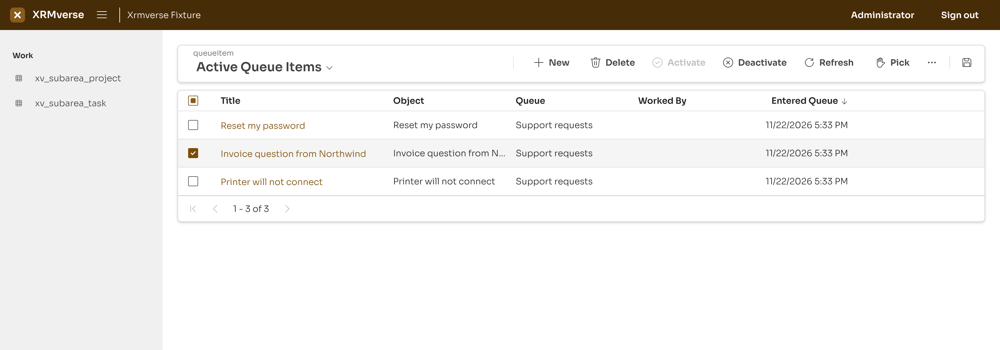

# Email and queues

[← xrmverse documentation](../README.md#documentation)

## Introduction

A **queue** is a shared list of work. A record that someone must handle (an email, a task, a phone call, an appointment or a
row of a custom activity table) is put in a queue as a **queue item**; a worker **picks** the item, works on it, and either
**releases** it back or removes it. Queues are what a contact center or a shared mailbox is built on: customers' messages
arrive in a team queue, and agents take them one by one. xrmverse follows the Dataverse model of tables, messages and error
codes for queues. Whether each detail matches a real Dataverse is not verified (see
[Known limits](#known-limits)).

**Outgoing email** (roadmap item 4.1b) sends an email for real: `SendEmail` with `IssueSend` true hands the email to the
**mailbox** of its sender (a user or a queue), and a background job sends it through the **email server profile** of that
mailbox, over SMTP or Microsoft Graph, with its attachments. A System Administrator sets up the profile, approves the
mailbox's address and tests the mailbox first (see [Outgoing email](#outgoing-email)).

**Incoming email** (roadmap item 4.1c) reads the inbox of a mailbox over IMAP or Microsoft Graph, in the background, and
turns each new message into a Received email: linked to its senders and recipients, to the email it answers and its
record, and, for a queue's mailbox, put in the queue (see [Incoming email](#incoming-email)).

This page covers queues (item 4.1a), outgoing email (item 4.1b) and incoming email (item 4.1c).



### Compared with Dataverse

| Area | xrmverse | Compared with Dataverse |
|---|---|---|
| Tables | `queue`, `queueitem`, `queuemembership` (seeded); type codes 2020, 2029 and 2027 | Same model; type codes from memory |
| Queue-enabled tables | `email`, `task`, `phonecall`, `appointment` and every custom activity | Same idea; `IsValidForQueue` can be switched on later, never off |
| Messages | `AddToQueue`, `RemoveFromQueue`, `RouteTo`, `PickFromQueue`, `ReleaseToQueue`, `AddPrincipalToQueue`, `RetrieveUserQueues` | Same names and parameters; behaviour in the details is partly from memory |
| Default queues | Every user and every owner team gets a private queue, named `<full name>` or `<team name>` | Same idea; whether access teams get one is not verified |
| Privacy | A private queue is visible to its members, its owner and the members of an owner team; only System Administrator bypasses it | Same idea |
| Security of the messages | Working an item needs the queue item privilege, its queue readable and Read on its record; `prvPickFromQueue` is not modelled (see [Security](#security-of-the-messages)) | **Differs** |
| Concurrency | No ETag or `If-Match` on queue items; the messages are serialized per record | **Narrower** |
| Counters | `numberofitems` and `numberofmembers` on a queue are not maintained | **Narrower** |
| Email tables | `emailserverprofile`, `mailbox`, `activitymimeattachment` (seeded); type codes 9605, 9606 and 1001 | Same model; type codes from memory |
| Email server profiles | SMTP (server type IMAP/SMTP, Basic authentication) and Exchange Online through Microsoft Graph (OAuth with Microsoft Entra ID, app-only token); any other server type, protocol or credential source is a 400 | **Narrower** |
| Mailboxes | One per user and per queue, created with it; approval of the address by a System Administrator and a successful test before it sends | Same idea |
| Sending | `SendEmail` with `IssueSend` true sends in the background, from the caller or from a queue the caller can read; retries 3 times on a temporary error | Same idea; a mailbox that cannot send fails the email at once (see [Known limits](#known-limits)) |
| Sender policy | `xrmverse_EmailSendFrom`: `userOrQueue` (default) or `queueOnly` | **Extra** (xrmverse extension) |
| Attachments | `activitymimeattachment` with its body in the file store, size limit and blocked extensions of the organization | Same idea; no chunked transfer |
| Tracking tokens | Off by default; on when the organization has a `trackingprefix` | **Differs**: a new Dataverse environment has them on (from memory) |
| Receiving email | Server-Side Synchronization over IMAP (Basic authentication) or Microsoft Graph, read-only, every `Mail:IncomingSyncInterval` | Same idea; no POP3, Exchange Web Services or Forward Mailbox; the interval is a server setting (see [Synchronization](#synchronization)) |
| Filtering | The five `incomingemailfilteringmethod` values of the user or queue | Same idea; senders are matched without smart matching |
| Duplicates | One email per `Message-ID` in the organization, the first mailbox wins; mail without `Message-ID` keyed by its content | Same idea; a message already tracked never gets an item in a second queue (see [Duplicates](#duplicates)) |
| Parties | `account`, `contact`, `systemuser` and `queue`, active records only; the sender linked only when exactly one record matches | **Narrower**: custom email-enabled tables are not matched |
| Correlation | `In-Reply-To` and `References`, tracking token, conversation index | Same order; no smart matching (method 6) |
| Who delivers | The mailbox's owner, or the administrator of the team that owns it, never SYSTEM | Same idea (from memory) |
| Delivery marker | Shared variable `xrmverse_MailboxDeliveryId` in the delivery's plug-in contexts | **Extra** (xrmverse extension) |
| Attachments not imported | A blocked or oversized incoming attachment is not stored; a note on the email names it | **Extra**: the note is xrmverse's own |

### Tasks at a glance

| Task | How | Chapter |
|---|---|---|
| Create a queue | `xrmd queue create`, or create a `queue` row | [Queues](#queues) |
| Put a record in a queue | `AddToQueue`, or **Add to queue** on a list | [Queue items](#queue-items) |
| Take an item to work on it | `PickFromQueue`, or **Pick** | [Working an item](#working-an-item) |
| Hand an item back, or to someone else | `ReleaseToQueue`, `RouteTo` | [Working an item](#working-an-item) |
| Add a person or a team to a queue | `AddPrincipalToQueue`, `xrmd queue member add` | [Members and privacy](#members-and-privacy) |
| Find the queues of a user | `RetrieveUserQueues` | [Members and privacy](#members-and-privacy) |
| Build a contact center on queues | Custom columns, steps, an application user | [Contact center use](#contact-center-use) |
| Set up an SMTP or Graph server | `xrmd mailbox profile create`, or the web admin's **Email** page | [Email server profiles](#email-server-profiles) |
| Get a mailbox ready to send | `xrmd mailbox approve`, `link`, `test`, or the Email page | [Mailboxes](#mailboxes) |
| Send an email | `SendEmail` with `IssueSend` true, or **Send** on the email form | [Sending](#sending) |
| Allow sending from queues only | `xrmverse_EmailSendFrom` = `queueOnly` | [Sender policy](#sender-policy-xrmverse_emailsendfrom) |
| Receive email in a mailbox | The profile's incoming columns, `xrmd mailbox link --incoming`, `test` | [Setting up receiving](#setting-up-receiving) |
| Choose which messages are kept | `incomingemailfilteringmethod` of the user or queue | [Filtering](#filtering) |
| Link replies to the email they answer | Headers, tracking tokens, conversation index | [Correlation](#correlation) |
| Let only deliveries create work in a queue | The shared variable `xrmverse_MailboxDeliveryId` | [Building a delivery guard](#building-a-delivery-guard) |

### Default forms and views

Every organization has a main form for `email`, `queue`, `queueitem`, `task`, `phonecall` and `appointment`, so a
model-driven app can create and open these records without a solution that brings forms. The email form shows From, To,
Cc, Bcc, Subject and Regarding, then the body, with Attachments and Details (owner, priority, due date) on the right; the
queue form shows the queue's settings and its active items in a subgrid; the queue item form shows the item, its queue,
who works it and since when. The task, phone call and appointment forms keep the activity's own fields on the left and
Details on the right. The views are **Open Emails** (the default), **All Emails**, **Sent Emails**, **Received Emails**,
**All Queues**, and **Open** (the default) and **All** for tasks, phone calls and appointments. Each form and view is
inserted only when its id is missing, so one you changed is never overwritten. A new organization gets them when it is
created; an existing one gets the missing ones at the server's next start, and the forms and views it already has are
left as they are. A seeded form or view is the default only when the table has no default main form (or default public
view) yet, so an organization's own default stays the default. An app that names its own form for one of
these tables opens that form instead.

## Queues

A queue is owned by a user or a team and has a name (up to 200 characters), a visibility (`queueviewtype`: 0 Public, 1
Private) and a state (`statecode`: 0 Active, 1 Inactive). `queuetypecode` is 1 (public and private queues are the same table
with a different visibility). A public queue can be read by everyone who holds Read on `queue`; a private queue only by the
people described in [Members and privacy](#members-and-privacy).

**Default queues.** When a user or an owner team is created, a private queue is created for it, named after the user's
`fullname` or the team's name in angle brackets (`<Jane Example>`), and the principal's `queueid` points at it. It is the
queue `RouteTo` uses when the target is a user or a team. A queue that still holds active items cannot be deleted (400), and neither can a team whose
default queue does: move the items on first.

## Queue items

A `queueitem` links one record (`objectid`, with the table's logical name in `objectidtypecode`, which the Web API can select
and filter on) to one queue (`queueid`). It also holds the
`title`, the `workerid` (who works on it), `workeridmodifiedon`, `enteredon` and a state: `statecode` 0 Active (status 1) or 1
Inactive (status 2). The relationship from a queue-enabled table to its items is `{SchemaName}_QueueItem` (singular) for the seeded activity
tables, for example `Email_QueueItem`, and `{logicalname}_QueueItems` for any other table, custom activities included. The
Web API navigation is `objectid_{table}`. Deleting the record deletes its items.

- **One active item per record.** A record has at most one active queue item. The exception is an email with status Received,
  which may sit in several queues. A direct Create of a second active item is refused (400), like `AddToQueue` on a record
  that is in a queue already, except that `AddToQueue` onto the record's current queue updates the item there.
- **Only queue-enabled tables.** `AddToQueue` on a record of another table is a 400 that names the table. An inactive record
  is refused, except a Received email.
- **State follows the record.** When a record leaves the active state (an activity is completed or cancelled), its active items
  become inactive. Reactivating the record does not reactivate them. A Received email keeps its items.
- **Seeded views.** The tables come with the system views **Active Queue Items**, **All Queue Items** and **Active Queues**.

`xrmd queue items <queue>` lists the items of a queue, and a queue item grid in a model-driven app shows them (see
[Surfaces](#surfaces)).

## Working an item

All the messages run through the same engine as the SDK and the Web API, so plug-in steps, workflow triggers, auditing and
security apply to them. The Web API bindings are:

| Message | Web API | What it does |
|---|---|---|
| `AddToQueue` | `POST queues({id})/Microsoft.Dynamics.CRM.AddToQueue` with `Target`, optional `SourceQueue` and `QueueItemProperties` | Creates the item (or moves it from `SourceQueue`); answers `QueueItemId` |
| `RemoveFromQueue` | `POST queueitems({id})/Microsoft.Dynamics.CRM.RemoveFromQueue` | Deletes the item |
| `RouteTo` | `POST RouteTo` with `Target` (queue, user or team) and `QueueItem` | Moves the item to the queue, or to the default queue of the user or team; the worker is kept |
| `PickFromQueue` | `POST queueitems({id})/Microsoft.Dynamics.CRM.PickFromQueue` with `SystemUser` and `RemoveQueueItem` | Sets `workerid` and `workeridmodifiedon`; with `RemoveQueueItem` true it deletes the item instead |
| `ReleaseToQueue` | `POST queueitems({id})/Microsoft.Dynamics.CRM.ReleaseToQueue` | Clears `workerid`; the item stays in its queue |
| `AddPrincipalToQueue` | `POST queues({id})/Microsoft.Dynamics.CRM.AddPrincipalToQueue` with `Principal` | Makes a user (or each member of a team) a member of the queue |
| `RetrieveUserQueues` | `GET systemusers({id})/Microsoft.Dynamics.CRM.RetrieveUserQueues(IncludePublic=…)` | The queues of a user |

The SDK requests have the same names (`AddToQueueRequest`, `PickFromQueueRequest`, and so on). A missing, mistyped or unknown
parameter is a 400.

- **Pick** on an item that someone else works on replaces the worker, with no error. Picking an inactive item is a 400. A
  worker that does not exist is a 404.
- **Release** clears the worker and leaves `workeridmodifiedon` as it was.
- **Route** needs the target queue to be readable by the caller; to a user or team, that principal's default queue, which is
  private. In practice only a System Administrator, the queue's owner, or a member can route to another person's default
  queue.
- **Security.** See the table below. The privilege `prvPickFromQueue` is not modelled.

### Security of the messages

Two rules cover every change to a queue item. A queue is **readable** by the caller when it is public, or when the caller (or
one of its teams) owns it, is a member, or has it shared for Read (see [Members and privacy](#members-and-privacy)); the
caller also needs Read on `queue`. This is the same rule every query uses.

- **Working an existing item** (Pick, Release, Remove, the queue an item leaves when it is routed or moved by `AddToQueue`, and
  a direct Update or Delete of a `queueitem`) needs the queue item privilege for the operation (Write, or Delete for Remove and
  Delete), the item's current queue readable, and Read on the item's record.
- **Placing an item** (`AddToQueue`, the destination of `RouteTo`, and a direct Create of a `queueitem`) needs Create on queue
  item, the destination queue readable, and Read on the record.

An Associate or Disassociate that repoints a queue item's `queueid` or `objectid` (for example over `Email_QueueItem` or
`queue_entries`) is a change to the item and follows the same rules: the item is worked (Write on queue item, its queue
readable, Read on its record), and the new queue must be readable or the new record readable.

Write on the `queue` record itself is needed only to change the queue (its name, owner, visibility and so on), never to work its
items.

| Message | What the caller needs |
|---|---|
| `AddToQueue` | Read on the record, Create on queue item, and the destination queue readable. An item that is elsewhere is moved by an Update, which also needs Write on queue item and the queue it leaves readable |
| `RemoveFromQueue` | Delete on queue item, the item's queue readable, Read on its record; the delete of the item is then checked as a Delete |
| `RouteTo` | Write on queue item, the queue the item leaves readable, Read on its record; Create on queue item and the destination queue (the target queue, or the default queue of the target user or team) readable |
| `AddPrincipalToQueue` | Append To on the queue |
| `PickFromQueue` | Write on queue item, the item's queue readable, Read on its record; the worker may be any user |
| `ReleaseToQueue` | Write on queue item, the item's queue readable, Read on its record |
| `RetrieveUserQueues` | Nothing extra for the caller's own id; Read on queue at Global depth for another user |

The Basic User role holds Read on queue, and Create, Read, Write, Delete, Append and Append To on queue item at Global depth (the
table has no owner). So a user with only Basic User works the items of the public queues and of the private queues they are a
member of, for the records they can read; nothing more is needed. A System Administrator passes the privacy part of these
checks.

## Members and privacy

A user becomes a member of a queue through `AddPrincipalToQueue`, or by associating on `queuemembership_association` (the
relationship name is from memory). Adding a team adds each of its members; adding someone twice changes nothing. `xrmd queue
member add <queue> <user|team>` does this from the command line.

A **private** queue, and the items in it, are visible to:

- its members, added directly;
- its owner, and the members of its owner team;
- a user or team it is shared with for Read;
- a System Administrator (the only role that bypasses the rule).

Everyone else sees neither the queue nor its items, in every query form (RetrieveMultiple, FetchXML, `$expand`). A queue item is readable when both its queue and its record are.

`RetrieveUserQueues` answers a user's queues: the queues the user is a member of, plus the default queues of the user's teams,
ordered by name and including inactive queues. Without `IncludePublic` only private queues come back; with it, every public
queue the caller can read is included. Asking for another user needs the Read privilege at Global depth on queue (403 otherwise).

## Outgoing email

Three tables carry outgoing email, all seeded in every organization:

- **`emailserverprofile`**: how to reach a mail server (SMTP, or Exchange Online through Microsoft Graph) and, when the
  profile holds them, the credentials. Only a System Administrator works with profiles (Basic User has no right on the table).
- **`mailbox`**: one per user and one per queue, created with the user or the queue (and at startup for users and queues
  that existed before). It points at a profile and keeps the result of the last test and the last error. The user or queue
  points at it through `defaultmailbox`.
- **`activitymimeattachment`**: the attachments of an email (see [Attachments](#attachments)).

An email leaves only when its sender's mailbox **can send**: the sender's address is approved, the mailbox is active, is
linked to a profile, uses Server-Side Synchronization for outgoing email (`outgoingemaildeliverymethod` 2) with
`enabledforoutgoingemail` on, and its last test succeeded (`outgoingemailstatus` 1 Success).

### Email server profiles

xrmverse accepts two kinds of profile. Every other combination of server type, authentication protocol and credential
source is refused with a 400 that names the value.

| Kind | `servertype` | `outgoingauthenticationprotocol` | `outgoingcredentialretrieval` | Other columns |
|---|---|---|---|---|
| SMTP | 4 IMAP/SMTP | 3 Basic (0 Auto Detect is stored as 3) | 1 the profile's credentials, or 0 each mailbox's own | `outgoingserverlocation`, `outgoingportnumber`, `outgoingusessl`, `outgoingusername`, `outgoingpassword` |
| Graph | 0 Exchange Server | 4 OAuth | 7 OAuth with Microsoft Entra ID | `exchangeonlinetenantid`, `oauthclientid`, `oauthclientsecret`, `serverauthority` 0 Public or 3 Automatic |

**SMTP.** `outgoingusessl` true opens TLS from the first byte (usually port 465); false requires STARTTLS (usually port
587). A server that offers no STARTTLS is refused before any credential is sent, unless the server setting
`Mail:AllowInsecureSmtp` is true (see [Configuration](#configuration)). Certificates are always validated. With credential
retrieval 1 one user name and password on the profile serve every mailbox of the profile; with 0, each mailbox has its own
`username` and `password`, which its owner may set.

**Graph.** The profile sends as any mailbox of the tenant with an app-only token (client credentials). Set it up once per
profile:

1. Register an application in Microsoft Entra ID for the tenant and create a client secret for it.
2. Grant it the **application** permissions `Mail.Send` and `Mail.ReadWrite` of Microsoft Graph, with admin consent. The
   message is created as a draft from the MIME message and then sent, so that the `Message-ID` is the one xrmverse wrote;
   the draft needs `Mail.ReadWrite`.
3. Limit the application to the mailboxes it should serve with an Exchange Online **application access policy** (a
   mail-enabled security group holding those mailboxes). Without one, the application can send as every mailbox of the
   tenant.
4. Create the profile with the tenant id (or domain), the application's client id and the secret.

**Secrets.** `outgoingpassword`, `incomingpassword`, `oauthclientsecret` and `mailbox.password` are write-only: no read
returns them (Retrieve, RetrieveMultiple, FetchXML, `$select`, audit, plug-in images and contexts). Their `is…set` columns
(`isoutgoingpasswordset`, `isincomingpasswordset`, `isoauthclientsecretset`, `mailbox.ispasswordset`) say whether one is
stored. They are stored unencrypted in the organization database,
as the webhook authentication value is (see [Known limits](#known-limits)).

```bash
# SMTP, credentials on the profile; the password is read from standard input
printf '%s\n' "$SMTP_PASSWORD" | xrmd mailbox profile create --name "Relay" --type smtp \
  --server smtp.example.com --port 587 --ssl false --username relay@example.com --secret-stdin
# Graph; the client secret is asked for on the terminal
xrmd mailbox profile create --name "Exchange Online" --type graph --tenant example.com --client-id <application id>
xrmd mailbox profile list
```

A secret is never a command-line argument: `--secret-stdin` reads one line from standard input, otherwise the CLI asks for
it on the terminal without echo. The web admin's **Email** page creates and edits profiles too (see
[Web admin](web-admin.md#email)).

### Mailboxes

Every user and every queue gets a mailbox, named after it, with its email address (`internalemailaddress` of a user,
`emailaddress` of a queue). Give a new queue its address with `xrmd queue create <name> --email <address>`; for an existing
queue or user, set the address on its record (in a model-driven app, in the web admin's **Tables**, or with the Web API). A new
mailbox gets the organization's default profile (`organization.defaultemailserverprofileid`) when one is set, and no profile
otherwise. Its incoming and outgoing delivery methods are those of its user or queue (None when they are empty), and they follow
it: writing `incomingemaildeliverymethod` or `outgoingemaildeliverymethod` on the user or queue writes the same value on its
mailbox, as in Dataverse, when the value differs from the one stored on the user or queue (writing back an unchanged
value leaves a mailbox linked directly alone). A profile alone does not make the mailbox send. To make it send:

1. **Approve the address.** A System Administrator sets `emailrouteraccessapproval` to 1 Approved on the user or the queue
   (`xrmd mailbox approve <mailbox>`, or **Approve** on the Email page). A new address starts as 2 Pending Approval. Changing
   the address of a user or queue resets the approval to Pending Approval (Empty when the address is removed) and the
   mailbox's test results to Not Run. Only a System Administrator may write the approval (403 otherwise).
2. **Link the mailbox to a profile.** A System Administrator sets `emailserverprofile`, `outgoingemaildeliverymethod` 2
   (Server-Side Synchronization) and `enabledforoutgoingemail` true on the mailbox: `xrmd mailbox link <mailbox> --profile
   <profile>`, or **Link to profile** on the Email page. Both send the same write as this Web API request:

   ```http
   PATCH /api/data/v9.2/mailboxes(<mailboxid>)
   {
     "emailserverprofile@odata.bind": "/emailserverprofiles(<profileid>)",
     "outgoingemaildeliverymethod": 2,
     "enabledforoutgoingemail": true
   }
   ```

   Delivery methods 1 (Outlook) and, for incoming email, 3 (Forward Mailbox) are refused on `mailbox`, `systemuser` and
   `queue`.
3. **Test it.** Writing `testemailconfigurationscheduled` true queues a test job (`xrmd mailbox test <mailbox> --wait`, or
   **Test** on the Email page). Only the mailbox's owner (the owning user, or a member of the owning team) or a System
   Administrator may start or withdraw a test. The test checks the approval, the mailbox, the profile and the credentials,
   then connects and signs in to the server without sending anything (Graph: it reads the mailbox's drafts folder). The
   outcome goes on the mailbox: `outgoingemailstatus` 1 Success or 2 Failure, `testmailboxaccesscompletedon`, and on failure
   `lastsyncerror` (the reason), `lastsyncerrorcount` and `lastsyncerroroccurredon`. The flag goes back to false.

```bash
xrmd mailbox list
xrmd mailbox approve support@example.com
xrmd mailbox test support@example.com --wait      # exit 5 when the test failed, with the reason
xrmd mailbox show support@example.com
```

### Sending

`SendEmailRequest { EmailId, IssueSend = true }` (Web API: `POST emails(<id>)/Microsoft.Dynamics.CRM.SendEmail` with
`{ "IssueSend": true }`) checks the email and its sender, sets it to Pending Send (state 1, status 6) and queues one send job
in the same transaction. **Send** on an email form does the same (see
[Model-driven apps](model-driven-apps.md#email-form)).

- **Sender.** The `from` party is the caller's own user (an empty `from` is filled with it) or a queue the caller can read
  (403 otherwise). Any other sender is a 400. The [sender policy](#sender-policy-xrmverse_emailsendfrom) may allow queues
  only.
- **Recipients.** At least one party in `to`, `cc` or `bcc`. A recipient that is only an address (no record) is a 400
  unless the organization's `allowunresolvedpartiesonemailsend` is on.
- **The job** runs as the caller. It builds the MIME message with the email's subject, its `description` as the HTML body,
  its parties and its attachments, stores the `Message-ID` in `email.messageid` and counts the attempt in
  `deliveryattempts` before it hands the message to the provider. Then:
  - **Sent:** state 1, status 3 Sent, `senton` now; the mailbox's `outgoingemailstatus` becomes Success.
  - **Temporary error** (the server is unreachable, an SMTP `4xx` answer, a Graph `429` or `5xx`): the job waits and tries
    again after 1, 5 and 15 minutes; each error goes on the mailbox (`lastsyncerror`, `lastsyncerrorcount`). After the third
    retry the email is Failed.
  - **Permanent error**, or a mailbox that cannot send (address not approved, no profile, not tested): the email is Failed
    (state 0, status 8) and the reason is the send job's message (`asyncoperation.message`). A failure of the server or of
    the credentials also sets the mailbox to Failure with the reason; a refused recipient fails only that email.
  - **Queue items.** `SendEmail` deactivates the email's active queue items. When the send ends Failed, the items it
    deactivated are active again in their queues, with their worker, unless the email has another active item meanwhile or
    the queue is inactive. A Sent email's items stay inactive.
- A Failed email is open again: correct it and send it again.
- `IssueSend` false still marks the email as Sent without sending anything (see
  [Activities and notes](activities.md#sendemail)).

Each send job is a system job (`asyncoperation.operationtype` 99011, regarding the email; a mailbox test is 99012).

### Sender policy (`xrmverse_EmailSendFrom`)

The environment setting `xrmverse_EmailSendFrom` is an **xrmverse extension**: Dataverse has no such switch. It decides who
may be the sender of an email that leaves:

| Value | Effect |
|---|---|
| `userOrQueue` (default) | As in Dataverse: the caller's own user or a queue the caller can read |
| `queueOnly` | Only a queue the caller can read. `SendEmail` with `IssueSend` true is a 400 naming `xrmverse_EmailSendFrom` when `from` is a user or empty; the send job checks again, so an email queued before the switch fails with the same reason |

`IssueSend` false is not affected (nothing leaves). Set the value with the **Send only from queues** switch on the web
admin's Email page, or write an `organizationsetting` row for the setting definition `xrmverse_EmailSendFrom` (the same way
as `xrmverse_AppOnLoad`, see [Model-driven apps](model-driven-apps.md#xrmverse-extensions)). A solution that relies on the
setting does not carry it into Dataverse.

### Attachments

An attachment is an `activitymimeattachment` row whose `objectid` is the email, with `filename`, `mimetype` and `body`
(base64). The body lives in the file store, as a note's body does, and is read back with Retrieve or `$select=body`.

- Attachments are added and changed only while the email is open (Draft or Failed); they need Write on the email, and
  reading one needs Read on the email.
- A body larger than `organization.maxuploadfilesize`, or a file name whose extension is in
  `organization.blockedattachments`, is refused (400).
- `organization.blockedattachments` holds extensions separated by `;`. A new organization gets Dataverse's default list, as
  Learn gives it: `ade;adp;app;asa;ashx;asmx;asp;bas;bat;cdx;cer;chm;class;cmd;com;config;cpl;crt;csh;dll;exe;fxp;hlp;hta;htr;`
  `htw;ida;idc;idq;inf;ins;isp;its;jar;js;jse;ksh;lnk;mad;maf;mag;mam;maq;mar;mas;mat;mau;mav;maw;mda;mdb;mde;mdt;mdw;mdz;msc;`
  `msh;msh1;msh1xml;msh2;msh2xml;mshxml;msi;msp;mst;ops;pcd;pif;prf;prg;printer;pst;reg;rem;scf;scr;sct;shb;shs;shtm;shtml;`
  `soap;stm;tmp;url;vb;vbe;vbs;vsmacros;vss;vst;vsw;ws;wsc;wsf;wsh;svg`. An organization made before this version gets the same
  list once, at its first start, only when the column is empty: a list an administrator set is kept, and a list cleared
  afterwards is not set again. Change it by updating the `organization` row (for example with the Web API,
  `PATCH organizations(<id>)` with `blockedattachments`).
- `email.attachmentcount` follows the rows. Deleting the email deletes its attachments.
- `InitializeAttachmentBlocksUpload` and `InitializeAttachmentBlocksDownload` (chunked transfer) are refused: a body travels
  in one request.

See [Activities and notes](activities.md#what-is-refused) for the related refusals.

### Tracking tokens

Tracking tokens are **off** by default: the organization has no `trackingprefix`. A new Dataverse environment has them on
(from memory, checklist 7).
To turn them on, set `trackingprefix` (for example `CRM:`), `trackingtokeniddigits`, `nexttrackingnumber` and, optionally,
`maximumtrackingnumber` on the `organization` row. Then:

- `SendEmail` with `IssueSend` true uses the `TrackingToken` it is given, or else takes the next one: the prefix followed by
  the number padded to `trackingtokeniddigits` digits. It appends the token to the subject (unless the subject holds it
  already) and stores it in `email.trackingtoken`. A subject that already carries a token in the current format (the prefix
  followed by at least `trackingtokeniddigits` digits), such as a Failed email sent again, keeps that token: no new number is
  taken and nothing is appended. A subject that would become too long, or a number past `maximumtrackingnumber`, is a 400.
- `trackingtokenidbase` is not supported: writing a value other than empty or 0 is a 400 that names the column.
- `GetTrackingTokenEmail` (SDK, or `POST /api/data/v9.2/GetTrackingTokenEmail`) returns the next token; with tracking off it is
  a 400 that names `trackingprefix`.

Incoming email uses the token to link replies (see [Correlation](#correlation)).

### Configuration

| Key | Default | Meaning |
|---|---|---|
| `Mail:AllowInsecureSmtp` | `false` | Allow an SMTP session without TLS when the server offers no STARTTLS. For test and development servers only: user names and passwords then travel in clear text |
| `Mail:GraphBaseUrl` | `https://graph.microsoft.com/v1.0` | The Microsoft Graph endpoint the Graph profiles call |
| `Mail:AllowInsecureImap` | `false` | Allow an IMAP session without TLS when the server offers no STARTTLS. For test and development servers only, as `Mail:AllowInsecureSmtp` |
| `Mail:IncomingSyncInterval` | `00:01:00` | The time between two synchronization passes of a mailbox; at least `00:00:10` |
| `Mail:IncomingBatchSize` | `50` | The most messages one pass lists, from 1 to 500 |

The server refuses to start when `Mail:IncomingSyncInterval` is under 10 seconds or `Mail:IncomingBatchSize` is outside 1
to 500, with a message that names the key.

They are ASP.NET configuration keys: as environment variables, write them as `Mail__AllowInsecureSmtp`. See
[Configuration](configuration.md).

## Incoming email

A mailbox that **can receive** is read by a background job, and each new message of its inbox becomes a Received `email`.
A mailbox can receive when the address of its user or queue is approved, the mailbox is active and linked to a profile,
its incoming delivery method is Server-Side Synchronization (`incomingemaildeliverymethod` 2) with
`enabledforincomingemail` on, and its last incoming test succeeded (`incomingemailstatus` 1 Success).

The server reads the mailbox and never changes it: no message is deleted, moved or flagged (IMAP opens the inbox
read-only and fetches without setting `\Seen`), so the people who use the mailbox in a mail client keep working as before.

### Setting up receiving

1. **The incoming side of the profile.**
   - **IMAP** (an SMTP profile, `servertype` 4): set `incomingserverlocation`, `incomingportnumber`, `incomingusessl` and the
     credentials. `incomingusessl` true (the default when empty) opens TLS from the first byte (port 993 by default); false
     requires STARTTLS (port 143 by default), and a server that offers none is refused before any credential is sent, unless
     `Mail:AllowInsecureImap` is true. `incomingauthenticationprotocol` is 3 Basic (0 Auto Detect is stored as 3).
     `incomingcredentialretrieval` 1 takes `incomingusername` and `incomingpassword` from the profile; 0 (or empty) takes each
     mailbox's own `username` and `password`. Any other protocol or credential source is a 400 that names the value.
   - **Graph** (`servertype` 0): nothing more. The incoming protocol and credential source take the outgoing ones (4 OAuth,
     7 OAuth with Microsoft Entra ID), and the profile reads the inbox with the same app-only token. Reading needs
     `Mail.Read`, which the `Mail.ReadWrite` permission of [the Graph set-up](#email-server-profiles) already covers; the
     application access policy limits the mailboxes it can read as it limits the ones it can send from.

   `xrmd mailbox profile create` and the web admin's profile dialog set the outgoing side only: write the incoming columns
   on the profile with the Web API or the SDK.

   ```http
   PATCH /api/data/v9.2/emailserverprofiles(<profileid>)
   {
     "incomingserverlocation": "imap.example.com",
     "incomingportnumber": 993,
     "incomingusessl": true,
     "incomingauthenticationprotocol": 3,
     "incomingcredentialretrieval": 1,
     "incomingusername": "support@example.com",
     "incomingpassword": "<password>",
     "usesamesettingsforoutgoingconnections": false
   }
   ```

   `usesamesettingsforoutgoingconnections` true makes the send use the incoming credentials (credential source, user name
   and `incomingpassword`) instead of the outgoing ones. It applies only when the profile has an incoming server
   (`incomingserverlocation`): a profile without one keeps sending with its outgoing credentials, whatever the value.
2. **Link the mailbox for receiving.** `xrmd mailbox link <mailbox> --profile <profile> --incoming` also writes
   `incomingemaildeliverymethod` 2 and `enabledforincomingemail` true (add `--no-outgoing` to leave the outgoing columns as
   they are). On the web admin's Email page, turn on **Receive email** in the **Link to profile** dialog. Only a System
   Administrator may change a mailbox's profile.
3. **Approve and test.** Approve the address as for sending, then test the mailbox (`xrmd mailbox test <mailbox> --wait`).
   When the mailbox receives, the test checks the incoming side too: the delivery user (see
   [Who delivers](#who-delivers-the-delivery-user)) and the connection, opening the inbox read-only. The outcome goes to
   `incomingemailstatus`, and the reason of a failure to `lastsyncerror`, the column both sides write. A successful
   incoming test starts the synchronization.

Changing the mailbox's profile, user name, password, incoming delivery method or `enabledforincomingemail` sets
`incomingemailstatus` back to Not Run: test the mailbox again. So does a new email address of the mailbox's user or queue,
and another incoming delivery method set on the user or queue. Each of these forgets the stored position: the next
synchronization starts again from `processemailreceivedafter`, and the [duplicate rule](#duplicates) keeps the messages
already imported from coming in twice. A pass still running when the settings change stores nothing more and ends, even
when a new test succeeds before it finishes.

### Synchronization

Each mailbox that can receive has one synchronization job (`asyncoperation.operationtype` 99013, named `SyncMailbox`,
regarding the mailbox and owned by the delivery user). It runs one **pass**, then waits for the next one,
`Mail:IncomingSyncInterval` later (one minute by default):

- The first pass sets `processemailreceivedafter` to its own time. Messages that reached the inbox earlier are never
  imported; the column is the server's (a write is a 400).
- A pass lists up to `Mail:IncomingBatchSize` messages (50 by default) after the stored position: the last IMAP UID read
  (a new UIDVALIDITY of the folder starts again from `processemailreceivedafter`), or the Graph delta link. A delta link
  Graph no longer accepts (`410 Gone`, or the error codes `syncStateNotFound`, `syncStateInvalid` and `resyncRequired`,
  given when the delta token expired) is dropped, and the listing starts again from `processemailreceivedafter` in the same
  pass; the [duplicate rule](#duplicates) keeps the messages already imported from coming in twice. When the server has
  more, the next pass starts at once.
- Each message is imported in a transaction of its own, through the pipeline (see [The received email](#the-received-email)),
  and the position after it is stored, so an interrupted pass goes on after the last message it imported.
- A pass that ends well sets `lastsuccessfulsynccompletedon` and `lastsyncerrorcount` 0. It leaves the text of
  `lastsyncerror` as it was, so the last error stays visible.
- The server checks every 5 minutes, and at startup, that each mailbox that can receive has its job, and queues the
  missing ones.

**Failures.**

| What failed | What happens |
|---|---|
| One message: its import refused by its pipeline (a plug-in, a validation) or by its own data; the server refuses to give it (an IMAP `NO` or `BAD` on its fetch, a Graph `4xx` other than `401` and `403` on its content); it is not readable MIME; any other error of its reading or import that is not the database, the network or a timeout | The pass stops before the message and tries it again at the next interval. After the third failure in a row the message is skipped, the pass goes on after it, and `lastsyncerror` names its `Message-ID` (or its server id) and the reason |
| A missing privilege of the delivery user (403) | Recorded in `lastsyncerror`, not counted against the message; the pass is tried again at the next interval. When the same message is refused this way three passes in a row, `incomingemailstatus` is set to 2 Failure with the reason, and the job ends until a new successful test (the message is never skipped for it) |
| The mailbox: authentication, TLS, its set-up, the delivery user (a team without an administrator, a disabled user) | `incomingemailstatus` 2 Failure with `lastsyncerror`, `lastsyncerrorcount` and `lastsyncerroroccurredon`; the job ends, and only a new successful test starts it again |
| Anything else: the network, the database, a timeout, a Graph `429` or `5xx` | Recorded in `lastsyncerror`; the status is kept, nothing counts against a message, and the next pass runs at the next interval |

A skipped message is remembered until the stored position moves past it, so it is not tried again. For a message without
`Message-ID` the count of failures restarts after an IMAP UIDVALIDITY reset, because its server id changes.

A mailbox that can no longer receive (disabled, unlinked, not tested) ends its job at its next pass, and the job's message
says why.

### Filtering

The mailbox owner's **incoming email filtering** decides which messages are kept. For a user's mailbox it is the user's
`usersettings.incomingemailfilteringmethod` (default 2); for a queue's mailbox, the queue's `incomingemailfilteringmethod`
(default 0).

| Value | Keeps |
|---|---|
| 0 | Every message |
| 1 | Only messages that [correlate](#correlation) with an email of the organization |
| 2 | Messages whose sender matches at least one active contact or account |
| 3 | Messages whose sender matches at least one record of the [party tables](#parties) |
| 4 | Nothing |

An ambiguous sender (several matches) is admitted by 2 and 3. A message the filter does not keep is passed over and not
imported later, even if the filter changes.

### Duplicates

Every message has a **key**, kept for the whole organization: its `Message-ID` (case kept, angle brackets and spaces
removed). A message without one is keyed by its content: the `Date`, `From`, `To` and `Subject` headers and the length of
its body. A `Message-ID` longer than 998 characters counts as none. Sent email registers its key too.

The first mailbox that imports a message owns its `email`. When a message whose key is already known arrives, nothing is
written, whichever mailbox reads it:

- A message the organization sent itself, to one of its own user or queue mailboxes, stays one email (the sent one) and
  gets no queue item.
- A message sent to several mailboxes of the organization (a user and a queue, or two queues) becomes one email, in the
  mailbox that reads it first. A message first imported by a user's mailbox and later seen by a queue's mailbox therefore
  reaches no queue, and a message already in one queue gets no item in a second one.

### Parties

Each address of `From`, `To`, `Cc` and `Bcc` is looked up, ignoring case, in four tables: active `account` and `contact`
(`emailaddress1`, `emailaddress2` and `emailaddress3`), enabled `systemuser` (`internalemailaddress`) and active `queue`
(`emailaddress`).

- **A recipient** gets one party per matching record, or one party with only `addressused` when nothing matches.
- **The sender** is linked only when exactly one record matches; the email's `emailsender` is then that record. With no
  match, or several, the party has only `addressused`; several matches also set `isduplicatesenderunresolved` true.
- A matching record that the delivery user cannot read is not linked: its party keeps the address only.
- `sender` holds the sender's address and `torecipients` the `To` addresses separated by `;`.

### Correlation

A new message is linked to an earlier email of the organization, its **parent**, in this order; the first hit wins and its
method goes to `correlationmethod`:

1. **Headers** (method 3), when `organization.emailcorrelationenabled` is on (the default): the `In-Reply-To` header, then
   the `References` header from the last id to the first, each looked up among the keys of the organization's email, sent
   or received.
2. **Tracking token** (method 4), when tracking tokens are on (see [Tracking tokens](#tracking-tokens)): the tokens of the
   subject, the last first, each equal to the `trackingtoken` of an email (the newest first). A text that looks like a token
   but is stored on no email is no hit.
3. **Conversation index** (method 5), when `emailcorrelationenabled` is on: the message's conversation index (from Graph,
   or the MIME `Thread-Index` header over IMAP) without its last 5-byte block equals the `conversationindex` of an email.

A hit sets `parentactivityid` to the parent and copies the parent's `regardingobjectid` (none when the parent has none). No
hit is method 0, with no parent and no regarding record. The regarding record is left out when the delivery user lacks
Append To on it, and the parent when the delivery user lacks Append To on the parent email. When both are left out, the
email is linked to nothing and `correlationmethod` is 0. A parent whose regarding table
cannot be resolved makes the import of the message fail (it counts as a [failure of the message](#synchronization)).

Email sent by xrmverse over SMTP stores no conversation index, and neither does email sent through Graph: replies to it
correlate through `In-Reply-To` and `References`, or through the tracking token.

### The received email

| Column | Value |
|---|---|
| `directioncode` | false (incoming) |
| `statecode`, `statuscode` | 1 Completed, 4 Received |
| `subject`, `description` | The subject; the HTML body, or the text body as HTML (encoded, line breaks as `<br>`) |
| `from`, `to`, `cc`, `bcc`, `emailsender`, `isduplicatesenderunresolved`, `sender`, `torecipients` | See [Parties](#parties) |
| `messageid` | The `Message-ID` that made the [key](#duplicates), with its angle brackets: the message's header, else the id the server reports (Graph's `internetMessageId`). Empty when the message was keyed by its content, or when the id with its brackets is longer than the column (320 characters): an id is never stored cut |
| `inreplyto`, `conversationindex` | From the message's headers (the id with its angle brackets) |
| `senton` | The `Date` header, else the time the server received the message |
| `regardingobjectid`, `parentactivityid`, `correlationmethod` | See [Correlation](#correlation) |
| `ownerid` | The mailbox's owner: its user, or the queue's owning user or team |

A value longer than its column (`subject`, `sender`, `torecipients`, `inreplyto`, `conversationindex`, for example) is cut
to the column's length.

Each part of the message that is not the text of its body becomes an `activitymimeattachment` of the email: the parts marked
as attachments, the inline parts an HTML body references by content id (images, which become plain attachments, see
[Known limits](#known-limits)) and the parts without a `Content-Disposition` header. One without a file name is named `attachment1`,
`attachment2` and so on, with the extension of its MIME type. An attachment whose extension is in
`organization.blockedattachments`, or that is larger than `maxuploadfilesize`, is not stored: a note (`annotation`) on the
email, "Attachments not imported", names each such file and the reason.

The email, its attachments and the note are created in one transaction. When the import fails, nothing of it stays.

### Queue delivery

A message read by a queue's mailbox is added to that queue with `AddToQueue` (Target the email, `DestinationQueueId` the
queue) in the same transaction. The `queueitem` Create nested in it runs through the pipeline, so the Create steps of
`queueitem` fire; the item's `title` is the subject. A delivery never picks, releases, routes or removes an item, and never
updates one.

### Who delivers: the delivery user

Every request of a delivery runs as the **delivery user**: the user who owns the mailbox, or, for a mailbox owned by a team
(a team-owned queue), the team's administrator (`team.administratorid`). It runs with that user's privileges and is never
SYSTEM: `createdby` of the email and of the queue item, and `UserId` and `InitiatingUserId` in plug-ins, webhooks and
workflows, are the delivery user. A team without an administrator, or a delivery user who is disabled, makes the mailbox's
test and synchronization fail with the reason.

### Building a delivery guard

A contact center that lets only deliveries create work in a queue can tell a delivery apart with the shared variable
`xrmverse_MailboxDeliveryId`, an **xrmverse extension** (Dataverse has no such variable: a guard ported to Dataverse needs
another rule there).

- **The `AddToQueue` of a delivery** has `Depth` 1, no `ParentContext`, `UserId` and `InitiatingUserId` the delivery user,
  `InputParameters` `Target` (the email, incoming and Received) and `DestinationQueueId` (the mailbox's queue), and
  `SharedVariables["xrmverse_MailboxDeliveryId"]` the mailbox id as a string (`D` format,
  `00000000-0000-0000-0000-000000000000`). The email Create and the attachment Creates of the delivery carry it too.
- **The nested `queueitem` Create** (`Depth` 2, `ParentContext` the `AddToQueue`) carries the same variable in its own
  `SharedVariables`.
- **Read it from your own context**: a guard reads `context.SharedVariables`, not `context.ParentContext.SharedVariables`.
- **Allow the delivery** when the variable is present, names a `mailbox` whose `regardingobjectid` is the destination
  queue, and `UserId` is that mailbox's delivery user.
- **It cannot be forged.** No request parameter of the SDK, SOAP or the Web API maps to it (a `tag` does not), and a plug-in
  or workflow step that adds, changes or removes it fails the message with a 400. Requests a plug-in makes do not carry it.
- **Asynchronous steps** of a delivery see the variable in their context; the requests they make do not carry it.
- **Webhooks** get it in the body's `SharedVariables` (also in a trimmed body).
- **Queue items moved by the server** never carry it and fire no step: `SendEmail` deactivating an email's items, and a
  failed send reactivating them, write the items without the pipeline.

See [Plug-ins](plugins.md#incoming-email-deliveries) for the pipeline side.

## Tasks

### Put an email in a queue and work it

```bash
xrmd queue create "Support"
xrmd queue member add "Support" jane@example.com
xrmd queue items "Support"
```

The queue commands above set up the queue. To put an email in it with the SDK, create the email, then run `AddToQueueRequest { Target = new EntityReference("email", id),
DestinationQueueId = queueId }`. The worker runs `PickFromQueueRequest { QueueItemId = item, WorkerId = workerId }`, and later
`ReleaseToQueueRequest`, `RouteToRequest` (to a private escalation queue, for example) or `RemoveFromQueueRequest`.

### Send an email from a queue

```bash
printf '%s\n' "$SMTP_PASSWORD" | xrmd mailbox profile create --name "Relay" --type smtp \
  --server smtp.example.com --port 587 --ssl false --username relay@example.com --secret-stdin
xrmd queue create "Support" --email support@example.com
xrmd mailbox link support@example.com --profile "Relay"
xrmd mailbox approve support@example.com
xrmd mailbox test support@example.com --wait
```

With the SDK, create the email with `from` = the queue and `to` = a contact, add an `activitymimeattachment`, then run
`SendEmailRequest { EmailId = id, IssueSend = true }`. The email is Pending Send until the job ends with Sent or Failed.

### Receive email in a queue

Give the profile its incoming side first (the `PATCH` in [Setting up receiving](#setting-up-receiving)), then:

```bash
xrmd queue create "Support" --email support@example.com
xrmd mailbox link support@example.com --profile "Relay" --incoming
xrmd mailbox approve support@example.com
xrmd mailbox test support@example.com --wait      # outgoing Success, incoming Success
xrmd mailbox show support@example.com             # incomingemailstatus, lastsuccessfulsynccompletedon, filtering
```

Each new message sent to support@example.com becomes a Received email with an active item in the Support queue. A reply
to an email sent from the queue gets that email as `parentactivityid` and its regarding record. With the SDK, find the
received email by its `messageid` (with angle brackets) and `directioncode` false, and its item by `objectid`.

### Use the command line

| Command | Does |
|---|---|
| `xrmd queue list [--public]` | Lists queues with their visibility and state; `--public` shows only public ones |
| `xrmd queue create <name> [--private] [--email <address>]` | Creates a queue, public unless `--private`, with its email address when given |
| `xrmd queue member add <queue> <user\|team>` | Adds a user or a team; the queue is named by name or id |
| `xrmd queue items <queue>` | Lists the items of a queue |

An unknown queue, user or team exits 4 (not found); a name that matches several queues exits 5 (use the id). Other refusals
are the server's (see [CLI](cli.md#exit-codes)).

| Command | Does |
|---|---|
| `xrmd mailbox list` | Lists the mailboxes: address, approval, profile, outgoing and incoming delivery with their last test |
| `xrmd mailbox show <id\|address>` | One mailbox, its profile, its last error, whether its password is set, its incoming status, last sync, `processemailreceivedafter` and filtering |
| `xrmd mailbox approve <id\|address>` | Approves the address of the mailbox's user or queue (System Administrator) |
| `xrmd mailbox link <id\|address> --profile <id\|name> [--incoming] [--no-outgoing]` | Links the mailbox to a profile, with Server-Side Synchronization and outgoing email on; `--incoming` turns receiving on the same way, `--no-outgoing` leaves the outgoing columns alone (System Administrator) |
| `xrmd mailbox test <id\|address> [--wait] [--timeout N]` | Starts a test; with `--wait` prints the result of both sides, exit 5 when either failed and 6 when it did not run in time |
| `xrmd mailbox profile create\|update\|list` | Email server profiles (`--type smtp\|graph`); the secret only with `--secret-stdin` or a prompt |

## Surfaces

- **Model-driven apps.** The list command bar has **Add to queue** on queue-enabled tables, and **Pick**, **Release**,
  **Route** and **Remove from queue** on the queue item grid (see [Model-driven apps](model-driven-apps.md)).
- **CLI.** `xrmd queue` (see [CLI](cli.md)).
- **Web API, SDK, SOAP.** The messages above.
- **Web admin.** Queues are tables like others; there is no queue-specific page. A table's page has a one-way switch to
  enable queues for the table (`IsValidForQueue`). The **Email** page (System Administrators) lists profiles and mailboxes
  with their outgoing and incoming tests and last sync, links mailboxes for sending and receiving, approves and tests them
  and sets the sender policy (see [Web admin](web-admin.md#email)).
- **Model-driven apps.** The email form: party lists, **Send**, the send status and attachments (see
  [Model-driven apps](model-driven-apps.md#email-form)).
- **CLI.** `xrmd mailbox` for profiles and mailboxes.

## Contact center use

A contact center needs more than the plain queue, and the following is allowed:

- **Your own columns, forms and views** on `queue` and `queueitem`, created like any custom column.
- **Plug-in steps and webhooks** on the queue messages (`AddToQueue`, `RemoveFromQueue`, `RouteTo`, `PickFromQueue`,
  `ReleaseToQueue`, `AddPrincipalToQueue`, `RetrieveUserQueues`) and on Create, Update and Delete of `queueitem`.
- **Picking for someone else.** An application user (a service client) can pick an item on behalf of a worker by passing that
  worker's id as `WorkerId`, so a routing service can assign work without signing in as each agent. It needs the rights of
  any worker: Write on queue item, Read on the records, and each private queue it serves readable (as a member, for example).

## Known limits

None of these is silent: each is refused with an explicit error or stated here.

- **Counters.** `queue.numberofitems` and `numberofmembers` are not maintained.
- **No optimistic concurrency.** Queue items have no ETag and no `If-Match` check; the messages are serialized per record, and
  the last writer wins on a plain Update.
- **Delete during add.** Deleting a queue while an item is being added to it at the same moment can remove the item that was
  just added.
- **Privilege model.** `prvPickFromQueue` is not modelled. Pick and Release need Write on queue item, the item's queue
  readable and Read on its record instead, like every change to an item (see [Security](#security-of-the-messages)).
- **Steps on automatic changes.** An item that the server deactivates itself, because its record was completed or cancelled,
  runs no plug-in steps; only the messages above do.
- **Migration.** Queues, queue items and memberships are not part of a migration from Dataverse yet (see
  [Migrating from Dataverse](migration.md)).
- **Not modelled.** Routing rules, and the Unified Routing and Omnichannel tables.
- **Queue form without members.** The default queue form lists the queue's items but not its members (there is no seeded
  view of users to list them); manage members with `xrmd queue member` or `AddPrincipalToQueue` (see
  [Members and privacy](#members-and-privacy)).
- **Secrets stored unencrypted.** Profile and mailbox passwords and the client secret are kept unencrypted in the
  organization database (never returned by a read), as the webhook authentication value is (#86).
- **Tracking tokens off by default.** A new organization has no `trackingprefix`; a new Dataverse environment has tracking
  tokens on (from memory). Set the prefix to turn them on (see [Tracking tokens](#tracking-tokens)).
- **A mailbox that cannot send fails the email.** When the sender's mailbox is not approved, has no profile or has not passed
  its test, the send job sets the email to Failed (state 0, status 8) with the reason on the job. From memory, Dataverse leaves
  such an email Pending Send until the mailbox works (checklist 8).
- **Interrupted send.** A send job interrupted after it started an attempt (the server stopped, for example) is not run again,
  so that the email is never sent twice: the email stays Pending Send. Check whether it arrived, then send it again.
- **Graph timeouts.** When a Graph send times out after Graph accepted the message, the retry can send it a second time.
- **Reopen and send again during a send.** Reopening an email that is Pending Send and sending it again while its first send
  job is still handing it to the server can deliver it twice.
- **Stop during a send.** A graceful stop of the server while a send job prepares the message, before it is handed to the
  server, also leaves the email Pending Send although nothing was sent. Reopen the email, then send it again.
- **Tracking token base.** `organization.trackingtokenidbase` is refused unless empty or 0: tokens are the prefix and the
  counter only.
- **Temporary recipient errors.** A temporary error about one recipient (for example SMTP `452`) that is still there after
  the last retry sets the mailbox to Failure, not only the email.
- **Columns the send job writes are not audited.** `messageid` and `deliveryattempts`, written by the send job, do not appear
  in the audit history of the email; the change of state does.
- **The send job's link to the email** is `asyncoperation.regardingobjectid`, a plain id column, not a lookup: filter on it
  by value (`regardingobjectid eq <email id>`), it has no navigation property.
- **Not modelled.** Sending as another user, delegate access to a mailbox, email templates (`SendEmailFromTemplate` and the
  template messages are refused), Outlook and Forward Mailbox delivery, IMAP/SMTP with OAuth, Exchange on-premises, and
  inline (content id) attachments in sent email.
- **Migration.** Mailboxes, profiles and email attachments are not part of a migration from Dataverse.
- **SMTP without TLS** works only with `Mail:AllowInsecureSmtp` true, a setting for test and development servers; IMAP
  without TLS only with `Mail:AllowInsecureImap` true.
- **Incoming: no smart matching.** Correlation uses headers, tracking tokens and the conversation index only;
  `correlationmethod` 6 (smart matching) is never set, and the smart matching settings of the organization are not
  seeded.
- **Incoming: four party tables.** Addresses are matched against `account`, `contact`, `systemuser` and `queue` only;
  custom email-enabled tables are not.
- **Incoming: inline images.** An image embedded in the HTML body (an inline part referenced by content id) is imported as a
  plain attachment of the email. The body keeps its `cid:` reference, which is not rewritten, so the image is not shown in
  place.
- **Incoming: HTML in the email form.** The email form shows the HTML body of a received email as source text (#335).
- **Incoming: one process per database.** The synchronization assumes one `xrmd` process per organization database, as the
  job worker does.
- **Incoming: conversation index of sent email.** Email sent by xrmverse (over SMTP or Graph) stores no conversation index,
  so the conversation index links only replies to received email; replies to sent email correlate through their headers
  or the tracking token.
- **Incoming: a tracked message in a second queue.** A message already imported gets no item in another queue; there is no
  setting to add one.
- **Incoming: mail without `Message-ID`.** Two messages without `Message-ID` that have the same `Date`, `From`, `To`,
  `Subject` and body length count as one: the second is not imported.
- **Incoming: a user's mailbox first.** A message imported by a user's mailbox and later read by a queue's mailbox (both
  were recipients) reaches no queue: the email stays with the user.
- **Incoming: no back-fill.** Messages that reached the inbox before the first synchronization pass
  (`processemailreceivedafter`) are not imported.
- **Incoming: profile's incoming side.** The CLI and the web admin set the outgoing side of a profile only; the incoming
  columns are written with the Web API or the SDK (see [Setting up receiving](#setting-up-receiving)).
- **Incoming: PreValidation in the transaction.** The steps of a delivery's messages at stage 10 (PreValidation) run inside
  the import's transaction, with the rest of the message: one message, one transaction (see
  [Plug-ins](plugins.md#incoming-email-deliveries)).
- **Incoming: parties and regarding records the delivery user cannot see.** A matching record that the delivery user cannot
  read is not linked as a party (the address stays), and a regarding record or parent email it cannot append to is left
  out. From memory, Dataverse may link more.
- **Not modelled for incoming email.** `DeliverIncomingEmail` and `CheckIncomingEmail` (refused), POP3, Exchange Web
  Services, Forward Mailbox, folder-level tracking, and changing the mailbox on the server (no delete, move or flag).

### Not yet verified against Dataverse

These behaviours were written from memory. Each is on the checklist of the plan, to be compared on a licensed Dataverse
environment:

- The type codes 2020, 2029 and 2027, and the relationship names `queue_team`, `{SchemaName}_QueueItem` (we use the singular; custom tables get `{logicalname}_QueueItems`) and
  `queuemembership_association`.
- The rights of Basic User on queue and queue item (Read on queue; Create, Read, Write, Delete, Append and Append To on queue
  item here), and that working an item needs no Write on its queue.
- The default queue's name, and whether access teams get one.
- `PickFromQueue` on an item someone else works on (the worker is replaced here), and on an inactive item (400 here).
- Reactivating an activity and its old queue item (the item stays inactive here).
- That a record leaving the active state deactivates its items with state 1 and status 2, except a Received email.
- Whether that automatic deactivation of a queue item fires `Update` steps on `queueitem` (none do here).
- `PickFromQueue` with `RemoveQueueItem` true (deletes without writing the worker), `workeridmodifiedon` set on Pick and left
  as it is on Release, and a missing worker being a 404 even then.
- `RetrieveUserQueues`: private queues only without `IncludePublic`, the meaning of "the user's queues", inactive queues
  included, order by name, the Global Read right needed for another user, and the plug-in context (`systemuser`, the user's
  id).
- The behaviour of `RetrieveUserQueues` when `UserId` is another user (403 here unless the caller has Global Read on queue).
- Whether `RouteTo` to a user or team needs read access to that principal's private default queue.
- `AddToQueue` refusing an inactive record (except a Received email); `RouteTo` keeping the worker; `AddToQueue` onto the
  current queue updating the existing item.
- Deleting a queue that holds active items being a 400.
- The type codes 9605 (`emailserverprofile`), 9606 (`mailbox`) and 1001 (`activitymimeattachment`).
- That an Exchange Online profile has server type 0, and the protocol and credential values it uses.
- The rights of Basic User on `mailbox` (Read and Write on their own) and on `emailserverprofile` (none).
- That changing a user's or queue's address resets the approval to Pending Approval.
- Adding or deleting an attachment of a sent email (adding is refused here, deleting is not).
- That Graph keeps the `Message-ID` of a message created from MIME.
- The tracking token's format, how "use tracking tokens" is stored, that `SendEmail` appends the token to the subject, and
  that `GetTrackingTokenEmail` needs no privilege beyond being signed in.
- The state, status and `deliveryattempts` of an email after a failed send, whether a Failed email keeps `senton`, and what
  Dataverse does with an email whose sender's mailbox cannot send.
- Whether a new Dataverse environment has tracking tokens on.
- Whether a Failed email sent again keeps its tracking token (kept here, when the subject carries it in the current format).
- The name of the type column of `queueitem.objectid` in the Web API (`objectidtypecode` here).
- That writing `testemailconfigurationscheduled` starts a mailbox test, who may do it, and whether a mailbox whose address is
  not approved can be tested (here the test fails with the reason, without contacting the server).
- Who creates an incoming email and its queue item (`createdby`, the plug-in `UserId` and `InitiatingUserId`), for a user's
  mailbox, a user-owned queue and a team-owned queue (here the owner, or the team's administrator).
- Whether a message already tracked gets a queue item in a second queue's mailbox (no second item here).
- A message sent from the organization to its own user or queue mailbox: one activity or two, and a queue item or not
  (one activity and no item here).
- `correlationmethod` for a hit on `References` only (3 here) and for no hit (0 here).
- The conversation index rule (here the parent is the index without its last 5-byte block).
- Filter 1 without smart matching, and filters 2 and 3 with an ambiguous sender (admitted here, the sender unresolved).
- That `emailcorrelationenabled` covers the headers and the conversation index but not tracking tokens.
- `senton` of an incoming email (the `Date` header here).
- When `processemailreceivedafter` is set and what it skips.
- The mailbox's state after an authentication failure, and whether a new test is needed (Failure and a new test here).
- `isduplicatesenderunresolved` for an ambiguous sender.
- What Dataverse records for a blocked or oversized incoming attachment (a note here).
- Inactive records and disabled users in address resolution (not matched here).
- The queue items of an email whose send failed (reactivated here).
- The title of a queue item created for an incoming email (the subject here).

## See also

- [Activities and notes](activities.md)
- [Model-driven apps](model-driven-apps.md)
- [CLI](cli.md)
- [Security](security.md)
- [Plug-ins](plugins.md)
- [Known issues and limitations](known-issues.md)
