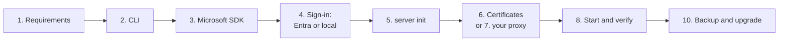

# Installing xrmverse

[← xrmverse documentation](../README.md#documentation)

## Introduction

This guide installs `xrmd` on a Linux server with Docker, from a released CLI and the published server image, with every
organization reachable at `https://<org>.<domain>` on port 443. For a quick try on a laptop, or to run a server built from a
clone, see [Getting started](getting-started.md). To start from a ready Azure VM, see [Deploy to Azure](deploy-to-azure.md).

Dataverse is a service Microsoft runs; xrmverse runs on your servers, so installing, securing, backing up and upgrading it
are your tasks. This guide walks through them in order.



| Chapter | What you do |
|---|---|
| [1. Requirements](#1-requirements) | Check the server, Docker, memory, network and DNS |
| [2. Install the CLI](#2-install-the-cli) | Download and verify `xrmd` |
| [3. Microsoft SDK](#3-microsoft-sdk) | Accept the license terms and install the SDK |
| [4. Entra app registrations](#4-entra-app-registrations) | Register one API per organization, or choose `--auth local` |
| [5. Initialize](#5-initialize) | Run `xrmd server init`: organizations, hosts, TLS, proxy, SQL Server or PostgreSQL |
| [6. Certificates](#6-certificates) | ACME, your own certificate or an internal CA; optional [SQL endpoint](#sql-endpoint) |
| [7. Your own reverse proxy](#7-your-own-reverse-proxy) | Only when you do not use the generated Caddy proxy |
| [8. Start and verify](#8-start-and-verify) | `server up`, `status`, `doctor`, signature check |
| [9. Offline install](#9-offline-install) | Install without Internet access |
| [10. Backup, upgrade and uninstall](#10-backup-upgrade-and-uninstall) | Day-to-day operations |
| [11. Not supported yet](#11-not-supported-yet) | Platforms and channels not offered |

> **Public downloads.** The v0.1.10 CLI and server archive are available from
> [xrmverse-releases](https://github.com/pwbit/xrmverse-releases/releases/tag/v0.1.10), separately from the source repository.
> The server image `ghcr.io/pwbit/xrmd:0.1.10` is also public and can be pulled without a GHCR login. For offline
> transfer, use the release's server archive and checksum with `docker load` before `server up`
> (see [Offline install](#9-offline-install)). Downloading an archive does not verify a registry signature.
> The source tree may be ahead of the release.

## 1. Requirements

- **Linux x86-64** (`linux/amd64`). The server image is built for that platform only; arm64 is not supported yet.
- **Docker Engine with Compose v2** (`docker compose version`). Install it from
  [Docker's documentation](https://docs.docker.com/engine/install/).
- **Memory and disk.** SQL Server needs at least 2 GB of RAM on its own (see
  [SQL Server on Linux requirements](https://learn.microsoft.com/sql/linux/sql-server-linux-setup#system-requirements)).
  As a starting point, plan about 1 GB of RAM per organization (one `xrmd` process each) and measure with your load.
  Disk: the images (a few GB), the SQL Server data volume (the bundled Express edition caps each database at 10 GB,
  see [SQL Server editions](sql-server-editions.md)), the `files` volume (file and image columns) and the backups.
  With `--database postgresql` the database is PostgreSQL 16 instead (the `pg-data` volume): see
  [PostgreSQL organizations](postgresql.md).
- **Network.** Outbound access to `ghcr.io` (the `xrmd` image), `docker.io` (the `caddy` image, and the `postgres` image
  with `--database postgresql`), `mcr.microsoft.com` (SQL Server) and `api.nuget.org` (the Microsoft SDK). Without it, follow [Offline install](#9-offline-install).
  Inbound: ports 80 and 443 for the generated proxy.
- **Names.** A DNS domain you control (for example `example.com`), with one record per organization or a wildcard.

## 2. Install the CLI

Download `xrmd-linux-x64.tar.gz` from the public release page
[xrmverse-releases](https://github.com/pwbit/xrmverse-releases/releases) and check its SHA-256 digest
against `SHA256SUMS` of the same release. That digest comes from the same place as the file, so it detects a corrupted
download, not a tampered release (the CLI archive is not signed yet); authenticity is checked on the server image,
which is signed: see `cosign verify` in [Start and verify](#8-start-and-verify).

```bash
V=0.1.10   # the release you install
curl -fLO https://github.com/pwbit/xrmverse-releases/releases/download/v$V/xrmd-linux-x64.tar.gz
curl -fLO https://github.com/pwbit/xrmverse-releases/releases/download/v$V/SHA256SUMS
sha256sum -c --ignore-missing SHA256SUMS
sudo tar -C /usr/local/bin -xzf xrmd-linux-x64.tar.gz xrmd
xrmd --version
```

The archive holds a self-contained executable (no .NET runtime needed) and its notices. Archives for macOS
(`osx-arm64`, `osx-x64`) and Windows (`win-x64`) exist for the client side; the server itself runs on Linux. A
`dotnet tool` on NuGet.org, Homebrew and winget are **not yet available** (the release carries the `xrmd` nupkg, see
[CLI `xrmd`](cli.md#install)).

The CLI version decides the server image: `server init` writes `ghcr.io/pwbit/xrmd:<CLI version>` to
`.env`. No `latest` tag exists.

## 3. Microsoft SDK

xrmverse ships without the Microsoft SDK assemblies: you install them yourself, after accepting Microsoft's license
terms. `server init --accept-microsoft-license` does it during init; otherwise run `xrmd sdk install --dir <dir>`
before `server up`, which refuses to start without it. See [Installing the Microsoft SDK](microsoft-sdk.md).

## 4. Entra app registrations

| Sign-in mode | `server init` option | Use it for |
|---|---|---|
| Development tokens | `--auth dev` (the default) | Evaluation only |
| Microsoft Entra ID | `--auth entra --tenant-id <tenant GUID> --admin-object-id <oid>` | Production with an Entra tenant |
| Local identity provider | `--auth local` | Production without Entra (see [Without Entra](#without-entra---auth-local)) |

Development tokens (`--auth dev`, the default) are for evaluation only. In production use Microsoft Entra ID
(`--auth entra --tenant-id <tenant GUID> --admin-object-id <oid>`), with one API app registration per organization:

- Application ID URI `https://<org>.<domain>` (Entra refuses a trailing slash; the server accepts the audience with
  or without it). That is the organization's default audience once it has a public host, and the URL the CLI derives
  its scope from, so the CLI works with no `ORG_<ORG>_AUDIENCE`. **Verify with a real token:** this assumes the
  token's `aud` claim is the Application ID URI. Entra v2.0 access tokens may carry the API's application (client) id,
  a GUID, instead; decode one token (`aud` claim) before going to production, and if it is the GUID set
  `ORG_<ORG>_AUDIENCE` to it. This has not been checked against a real tenant yet. Entra accepts an `https://` Application ID URI only on
  a domain verified in your tenant: see
  [Restrictions on identifier URIs](https://learn.microsoft.com/entra/identity-platform/identifier-uri-restrictions).
  If you cannot verify the domain, use an `api://` URI and set `ORG_<ORG>_AUDIENCE` (with the CLI limitation
  described in [Multiple organizations](multiple-organizations.md)).
- `accessTokenAcceptedVersion` 2 in the manifest and the tenant GUID: see
  [Development token](getting-started.md#development-token-auth_modedevelopment) for why.
- For the web admin, `UI_ENTRA_CLIENT_ID` and `UI_ENTRA_SCOPE`: see [Web admin](web-admin.md).

How to register an application is in Microsoft Learn:
[Register an application](https://learn.microsoft.com/entra/identity-platform/quickstart-register-app) and
[Expose a web API](https://learn.microsoft.com/entra/identity-platform/quickstart-configure-app-expose-web-apis).
`server init` prints, for each organization, the `xrmd auth login --profile <org> --url https://<host>/ …` command to
run once the server is up.

### Without Entra: `--auth local`

With `--auth local` the server is its own identity provider, so no app registrations are needed and nothing is sent to
Microsoft. `server init` generates each organization's administrator and a one-time initial password, shown once (and
written to `<dir>/secrets/<org>/admin-password`, a folder only that organization's container mounts; the server consumes the file at its first start). Every organization needs an
`https` host (`--domain` or `--public-host`, with a proxy and certificates as in section 6), because ServiceClient and MSAL
refuse other authorities. `pac` does not work in this mode. Users, TOTP, service clients, connection strings, backups and the
move to Entra are in [Local identity provider](local-idp.md).

## 5. Initialize

```bash
xrmd server init --dir /srv/xrmd --org acme --org zenith \
  --domain example.com --tls acme --acme-email admin@example.com \
  --accept-microsoft-license --accept-sql-server-eula
```

- **SQL Server.** Without `--sql-connection` a `sqlserver` service runs the Express edition (`--sql-edition` for
  another one, see [SQL Server editions](sql-server-editions.md)). `--sql-connection '<connection string>'` uses an
  existing SQL Server instead; its permissions and backups are in
  [Multiple organizations](multiple-organizations.md). The bundled SQL Server needs your acceptance of Microsoft's
  license terms for its edition: `--accept-sql-server-eula`, or answer the question init asks at a terminal (see
  [License terms](sql-server-editions.md#license-terms-accept_eula)).
- **PostgreSQL**. `--database postgresql` runs the organizations on a bundled `postgres` service
  (`postgres:16-alpine`), or on your own PostgreSQL 16 or later server with `--sql-connection "Host=…;Username=…;Password=…"`.
  No SQL Server license terms apply. Every feature works as on SQL Server, `--auth local` and `--tds-port` included; the
  engine cannot be changed later: see [PostgreSQL organizations](postgresql.md) before you choose it.
- **Hosts.** `--domain <domain>` gives every organization the host `<org>.<domain>`; `--public-host <org>=<host>`
  (repeatable) gives one organization another host. A host is a lower-case DNS name with at least two labels, unique
  across organizations. `server org add <name>` later gives the new organization `<name>.<domain>`, or
  `--public-host <host>`.
- **TLS** (`--tls`, required with a host and the generated proxy): `acme`, `files` or `internal`, see
  [Certificates](#6-certificates).
- **Proxy.** By default a Caddy proxy (`caddy:2.11.9`) is generated: the only service published outside loopback, on
  ports 80 and 443 of every address (`PROXY_BIND` in `.env` chooses another address). The organizations publish no host
  port (`--expose-ports` keeps their loopback ports for diagnostics) and reach the proxy on the compose network `edge`
  (`--edge-subnet`, default `172.31.250.0/24`, `/27` or larger); each one honors forwarded headers only from the
  proxy's address, `.10` of that subnet, and only for its own host. The other containers get addresses from the upper
  half of the subnet only (`172.31.250.128/25` by default), so no organization can take the proxy's address. `--no-proxy` is for your own proxy, see
  [Your own reverse proxy](#7-your-own-reverse-proxy).
- **SQL endpoint** (optional, `--tds-port`, with `--auth local`). Gives each organization a read-only SQL endpoint, see
  [SQL endpoint](#sql-endpoint).
- **DNS.** `init` prints the records to create: one `A`/`AAAA` record per host, or one wildcard `*.<domain>` record
  with `--domain`, pointing at this server (or at your proxy with `--no-proxy`). For the CLI the names must also resolve
  on the machine that runs it: `server doctor` reports a host that does not.

`.env` is the installation: `docker-compose.yml` and `Caddyfile` are rendered from it and start with
`# Generated by xrmd`; never edit them. The keys are listed in [Configuration](configuration.md#installation-keys).

## 6. Certificates

| `--tls` | Certificate | Renewal |
|---|---|---|
| `acme` | Let's Encrypt or another ACME CA, one per host | Automatic |
| `files` | Your own pair for every host | Yours |
| `internal` | Caddy's local CA | Automatic; clients must trust the root |

### ACME

`--tls acme --acme-email <e-mail>`. Caddy obtains and renews a certificate per host from Let's Encrypt (or
another ACME CA). The hosts must resolve publicly to this server, and port 80 (HTTP-01) or 443 (TLS-ALPN-01) must be
reachable from the internet.

### Your own certificate

`--tls files --tls-cert <pem> --tls-key <pem>`. One pair for every host: a wildcard
`*.<domain>` or a certificate whose SAN list names every host. `init` copies it to `<dir>/certs/server.crt` and
`server.key` (mode 600), mounted read-only into the proxy. The key must be unencrypted PEM; the certificate file may
hold the chain. `server up` and `server upgrade` refuse to start (exit 5) when a file is missing. Renewal is yours:
replace both files, then run `docker compose exec proxy caddy reload --config /etc/caddy/Caddyfile --force` in `<dir>`
(or `docker compose restart proxy`). `--force` is needed: the Caddyfile has not changed, and without it Caddy skips the
reload and keeps serving the old certificate; `server up` does not re-create a running proxy either.
`server doctor` warns 14 days before the served certificate expires and reports an error once it has expired or when
it does not cover the host.

### Internal CA

`--tls internal`. Caddy's own local CA, for tests, evaluation and air-gapped sites. Caddy issues
short-lived certificates (about 12 hours) and renews them itself; the root it signs them with is valid for years.
After each start `server up` exports that root to `<dir>/certs/caddy-root.crt` and records it in the dev profiles of
the organizations with a host (`CaFile` in `config.json`): the CLI trusts it **only** for that profile's host, with no
change to the machine's trust store. Profiles you create with `xrmd auth login` (Entra) get no `CaFile` yet: trust the
root on the machine instead, as for any other client. `server doctor` judges the root here: it warns 14 days before
`caddy-root.crt` expires; an expired served certificate or root is an error.

Every other client (browsers, ServiceClient, `pac`, XrmToolBox) must trust `caddy-root.crt`:

- **Windows**: `certutil -addstore -f Root caddy-root.crt` in an elevated prompt (machine store), or the
  Certificates MMC snap-in, Trusted Root Certification Authorities, Import. See
  [certutil](https://learn.microsoft.com/windows-server/administration/windows-commands/certutil).
- **macOS**: `sudo security add-trusted-cert -d -r trustRoot -k /Library/Keychains/System.keychain caddy-root.crt`,
  or open it in Keychain Access, System keychain, and set it to Always Trust.
- **Linux (Debian, Ubuntu)**: `sudo cp caddy-root.crt /usr/local/share/ca-certificates/xrmd-caddy-root.crt && sudo
  update-ca-certificates`. Other distributions have their own tool (`update-ca-trust` on Fedora and RHEL).

Firefox and some runtimes keep their own trust store. Remove the root from the clients when you retire the
installation.

### SQL endpoint

`--tds-port <port>` (with `--auth local` and a public host) gives the organizations a read-only SQL endpoint for SSMS,
Power BI and SqlClient: the first organization listens on `<port>`, the next ones on the next ports, and
`server org add <name> --tds-port <port>` adds one later. The port is published on every address (`XRMD_TDS_BIND` in
`.env` chooses another); open it in your firewall. It must differ from 80 and 443 with the generated proxy, and from the
ports of the other organizations. The endpoint requires TLS and serves the organization's host certificate:

- With the generated proxy, the `tds-certs` service copies each certificate into `<dir>/tds/<org>/` every 12 hours
  (ACME), every hour (`--tls internal`) or every 5 minutes (`--tls files`, the pair `certs/server.crt` and
  `server.key`). The server picks up a changed pair within about 10 seconds, and opens the endpoint once the files
  exist (with ACME this takes up to a few minutes, until the certificate is issued and copied).
- With `--no-proxy`, `--tds-cert <pem>` and `--tds-key <pem>` are required: one certificate covering every host,
  copied to `certs/tds.crt` and `certs/tds.key` (mode 600). Replace both files to renew; the copy follows within
  5 minutes. The endpoint does not go through your proxy: clients connect to the published port.

`server status` shows each organization's TDS port and certificate expiry, and `server doctor` checks the certificate.
Connecting, supported SQL, limits and troubleshooting are in [SQL endpoint](sql-endpoint.md).

## 7. Your own reverse proxy

With `--no-proxy --trusted-proxy <ip|cidr>` (repeatable) no proxy service is generated: your nginx, Traefik or IIS
ARR terminates TLS and forwards each host to its organization's port, which the compose file publishes on
`XRMD_BIND` (default `127.0.0.1`; set `XRMD_BIND` in `.env` to the address your proxy connects to when it runs on
another machine, and firewall it). `--tls` options are refused with `--no-proxy`.

```bash
# Your proxy runs on 10.0.0.5 and connects to the published ports over the network (XRMD_BIND in .env).
xrmd server init --dir /srv/xrmd --org acme --org zenith --domain example.com --no-proxy --trusted-proxy 10.0.0.5
```

### Which address to trust

The organizations honor `X-Forwarded-Proto`, `-Host` and `-For` only from the addresses in
`TRUSTED_PROXIES`, one hop deep, and only for their own host. That is the address the `xrmd` container sees, not the
one your proxy listens on. Trust a single address, never more than you must:
- a proxy on another machine arrives from its own address: give that one, as above;
- a proxy on the same host that connects to `127.0.0.1:<port>` arrives from the gateway of the compose project's
  default network, which Docker assigns at the first `server up`, so it is not known at `init`. You can start with
  Docker's default address range (`--trusted-proxy 172.16.0.0/12`), but **while that range is set, any container
  whose address is in it and that can reach an organization (a container on the same Docker network, for example) can
  forge forwarded headers for that organization's host**: it can set the scheme, host and client address the server
  uses for its URLs and logs. Narrow it right after the first start: read the gateway with
  `docker network inspect <project>_default --format '{{(index .IPAM.Config 0).Gateway}}'` (the project is the
  installation directory's name, in lower case), set `TRUSTED_PROXIES` in `.env` to that one address and run
  `server up` again.

### Checking the result

`curl https://acme.example.com/api/data/v9.2/` (with a token) answers an `@odata.context` that starts
with `https://acme.example.com/`. If it starts with `http://localhost`, the address is not trusted. An untrusted proxy also
breaks form scripts and web resources: the web session cookie is set without `Secure`, and every write a script makes with
it is refused with 403 (`0x80048306`, origin mismatch), because the server compares the browser's `Origin` with the scheme
and host it sees itself.

### What every proxy must do

| Requirement | Value |
|---|---|
| Original host and scheme | `X-Forwarded-Host`, `X-Forwarded-Proto` |
| Client address | `X-Forwarded-For`, replaced rather than appended |
| Request body size | Up to **128 MiB** (134,217,728 bytes, the server's limit for a solution import or a file upload) |
| Response timeout | **10 minutes**, because a synchronous `ImportSolution` holds its request until the import ends |
| WebSockets | Not needed |
| Port 80 | Redirect it to 443 yourself |

### nginx

One `server` block per organization:

```nginx
server {
    listen 443 ssl;
    server_name acme.example.com;
    ssl_certificate     /etc/nginx/certs/example.com.crt;
    ssl_certificate_key /etc/nginx/certs/example.com.key;

    client_max_body_size 128m;
    proxy_read_timeout   600s;
    proxy_send_timeout   600s;

    location / {
        proxy_pass http://127.0.0.1:5001;      # ORG_ACME_PORT
        proxy_set_header Host              $host;
        proxy_set_header X-Forwarded-Host  $host;
        proxy_set_header X-Forwarded-Proto $scheme;
        proxy_set_header X-Forwarded-For   $remote_addr;
    }
}
```

### Traefik

File provider; Traefik sets the `X-Forwarded-*` headers itself and has no body size limit by default.

```yaml
http:
  routers:
    acme:
      rule: Host(`acme.example.com`)
      entryPoints: [websecure]
      service: acme
      tls: {}
  services:
    acme:
      loadBalancer:
        servers:
          - url: http://127.0.0.1:5001   # ORG_ACME_PORT
```

In the static configuration set `entryPoints.websecure.transport.respondingTimeouts.readTimeout` (and `writeTimeout`)
to `600s`, and list only your own trusted addresses in `forwardedHeaders.trustedIPs`, so that headers sent by
clients are replaced.

### IIS with Application Request Routing (ARR)

On a Windows machine in front of the Linux host: install the URL Rewrite
and ARR modules, enable the proxy, then, per organization's site (binding `https`, host name `acme.example.com`):

```cmd
%windir%\system32\inetsrv\appcmd.exe set config -section:system.webServer/proxy /enabled:"True" /preserveHostHeader:"True" /reverseRewriteHostInResponseHeaders:"False" /timeout:"00:10:00" /commit:apphost
```

```xml
<!-- web.config of the acme site; allow HTTP_X_FORWARDED_HOST and HTTP_X_FORWARDED_PROTO under
     URL Rewrite, View Server Variables, first -->
<configuration>
  <system.webServer>
    <security>
      <requestFiltering>
        <requestLimits maxAllowedContentLength="134217728" />
      </requestFiltering>
    </security>
    <rewrite>
      <rules>
        <rule name="xrmd-acme" stopProcessing="true">
          <match url="(.*)" />
          <serverVariables>
            <set name="HTTP_X_FORWARDED_HOST" value="{HTTP_HOST}" />
            <set name="HTTP_X_FORWARDED_PROTO" value="https" />
          </serverVariables>
          <action type="Rewrite" url="http://linux-host.example.com:5001/{R:1}" />
        </rule>
      </rules>
    </rewrite>
  </system.webServer>
</configuration>
```

ARR adds `X-Forwarded-For` itself. Trust the IIS machine's address (`--trusted-proxy`). Microsoft Learn describes the
modules in [Reverse proxy with URL Rewrite and ARR](https://learn.microsoft.com/iis/extensions/url-rewrite-module/reverse-proxy-with-url-rewrite-v2-and-application-request-routing).

## 8. Start and verify

```bash
xrmd server up --dir /srv/xrmd
xrmd server status --dir /srv/xrmd     # one row per organization, with its public URL
xrmd server doctor --dir /srv/xrmd     # the server's checks, plus dns and certificate per public host
curl https://acme.example.com/healthz  # -> ok
```

`status` exits 1 unless every organization is healthy; `doctor` exits 1 on any error (a host that does not resolve on
this machine, a certificate that has expired or does not cover the host). In dev mode set `XRMD_DEV_SIGNING_KEY` to
`AUTH_DEV_SIGNING_KEY` of `.env` first; with Entra sign in with the commands `init` printed.

Verify the image signature with [cosign](https://docs.sigstore.dev/cosign/system_config/installation/). The release
signs the image without a key, from its GitHub Actions workflow (the maintainers' repository `pwbit/xrmverse-private`
since November 2026, `pwbit/xrmverse` before):

```bash
cosign verify ghcr.io/pwbit/xrmd:<version> \
  --certificate-identity-regexp '(?i)^https://github\.com/pwbit/xrmverse(-private)?/\.github/workflows/release\.yml@refs/tags/v' \
  --certificate-oidc-issuer https://token.actions.githubusercontent.com
cosign verify-attestation --type cyclonedx ghcr.io/pwbit/xrmd:<version> \
  --certificate-identity-regexp '(?i)^https://github\.com/pwbit/xrmverse(-private)?/\.github/workflows/release\.yml@refs/tags/v' \
  --certificate-oidc-issuer https://token.actions.githubusercontent.com > /dev/null   # the server SBOM
```

## 9. Offline install

The release carries the server image as `xrmd-server-<version>-linux-amd64.tar.gz` and its `.sha256`. It holds the
`xrmd` image only: SQL Server, Caddy and the Microsoft SDK are never redistributed, so you fetch them yourself on a
connected machine.

On a connected machine:

```bash
docker pull mcr.microsoft.com/mssql/server:2022-latest   # not with --sql-connection
docker pull caddy:2.11.9                                 # not with --no-proxy
docker save mcr.microsoft.com/mssql/server:2022-latest caddy:2.11.9 | gzip > third-party-images.tar.gz
```

Download the Microsoft SDK package `Microsoft.PowerPlatform.Dataverse.Client` 1.2.27 from NuGet.org (the only version
`xrmd` accepts, checked against its pinned hash), and the CLI archive. Copy everything to the server, then:

```bash
sha256sum -c xrmd-server-<version>-linux-amd64.tar.gz.sha256
docker load -i xrmd-server-<version>-linux-amd64.tar.gz
docker load -i third-party-images.tar.gz
xrmd server init --dir /srv/xrmd --org acme --domain example.com --tls internal   # or --tls files
xrmd sdk install --dir /srv/xrmd --from microsoft.powerplatform.dataverse.client.1.2.27.nupkg
xrmd server up --dir /srv/xrmd
```

`server up` starts the loaded images without pulling. ACME needs the internet: use `files` or `internal`.

What these checks cover: the `.sha256` comes from the same release as the archive, so `sha256sum -c` detects a
corrupted copy, not a substituted one; `cosign verify` (section 8) verifies the image in the registry, not the archive
you `docker load`. To tie the two together, on the connected machine run `cosign verify` on
`ghcr.io/pwbit/xrmd:<version>`, then compare the config digest of that registry image with the one the
archive names; they must be equal:

```bash
docker buildx imagetools inspect --raw ghcr.io/pwbit/xrmd:<version> | jq -r .config.digest
tar -xzOf xrmd-server-<version>-linux-amd64.tar.gz manifest.json | jq -r '.[0].Config'   # names the same sha256 digest
```

Without that comparison, the archive is only as trustworthy as the channel you downloaded it from.

## 10. Backup, upgrade and uninstall

### Backup and restore

`xrmd org backup <org> --profile <org>` writes a `COPY_ONLY` `.bak` and a `.files.tar` to the
`backups` volume; `xrmd org restore <org> --file <path>` restores them. See [CLI `xrmd`](cli.md) and
[Multiple organizations](multiple-organizations.md) (external SQL Server). Also keep a copy of `<dir>/.env` (it holds
the secrets) and of `<dir>/certs`. On PostgreSQL `org backup` writes a `.dump` of `pg_dump` and the `.files.tar` to the same
`backups` volume (see [PostgreSQL organizations](postgresql.md#backup-and-restore)).

### Upgrade

`xrmd server upgrade --dir <dir> --to <version>` rewrites the tag of `XRMD_IMAGE` in `.env`, pulls,
restarts every organization and waits until each one is healthy. Install the CLI of the same version first, so that
the generated files match the server. `--to latest` finds the newest release on GitHub and writes its exact version;
it stops before changing anything when the CLI is older than that release. `xrmd server versions --dir <dir>` lists the
releases and the one installed. Offline, `upgrade` cannot pull: `docker load` the new archive, set the tag of
`XRMD_IMAGE` in `.env` and run `server up`. A new Caddy version comes with a new CLI release.

The server image moved from `ghcr.io/power-builders-italia/xrmd` to `ghcr.io/pwbit/xrmd` when the GitHub
organization was renamed. `server upgrade` moves an installation that still names the old repository to the new one;
offline, set `XRMD_IMAGE` to `ghcr.io/pwbit/xrmd:<version>` yourself.

### Uninstall

```bash
xrmd server down --dir /srv/xrmd --volumes --yes   # also deletes the data volumes: back up first
docker network rm <project>_edge                   # if it is left over (see below)
docker image rm ghcr.io/pwbit/xrmd:<version> caddy:2.11.9 mcr.microsoft.com/mssql/server:2022-latest
xrmd auth logout --profile acme                    # each profile of the installation
rm -rf /srv/xrmd
```

When the last organization with a host is removed (`server org remove`), the proxy and the `Caddyfile` go away but
the Docker network `<project>_edge` stays: the compose file no longer declares it, so `server down` does not remove it
either. `docker network rm <project>_edge` does (the project is the installation directory's name, in lower case).
Remove `caddy-root.crt` from the clients that trusted it.

## 11. Not supported yet

| Not supported yet | Notes |
|---|---|
| A Windows service, hosting in IIS, systemd units | The server runs in Docker on Linux |
| Kubernetes or Helm | |
| `arm64` servers | The image is `linux/amd64` only |
| A CLI on NuGet.org, Homebrew or winget, and public images | Wait for the first public release |

## See also

- [Configuration](configuration.md), [Multiple organizations](multiple-organizations.md)
- [Local identity provider](local-idp.md), [SQL Server editions](sql-server-editions.md), [PostgreSQL organizations](postgresql.md)
- [CLI xrmd](cli.md), [Observability](observability.md)
