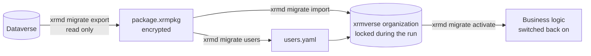

# Migrating from Dataverse

[← xrmverse documentation](../README.md#documentation)

## Introduction

The migration is a one-off move of an application from a Dataverse environment into an xrmverse organization: schema, users,
records with their ids and system fields, relationships, files and notes. It goes through an encrypted **package**, so the
machine that imports needs no route to Dataverse.

**Status: M1–M6 complete, accepted on a real Dataverse environment (November 18, 2026).** Export, the encrypted package, the
import on the server with its verification, `xrmd migrate run`, `xrmd migrate activate` and the `migrate_*` MCP tools are
available. The gaps found during the acceptance are listed in [Known issues and limitations](known-issues.md).



### What is carried

| Carried | Not carried |
|---|---|
| Chosen solutions (unmanaged, and managed from their original file) | Microsoft first-party solutions |
| Custom schema outside solutions (tables, columns, N:N, option values) | Rollup and formula columns outside the exported solutions, prompt columns, virtual tables, multi-table lookups (reported as `unsupported`) |
| Business units, teams, users, memberships, roles, shares, field security assignments | Forms, views, charts, roles and processes outside the exported solutions (warning `default-solution-component`) |
| Records with their ids, `createdon`, `createdby`, `modifiedon`, `modifiedby`, `overriddencreatedon`, owner and business unit | Standard Dataverse tables xrmverse does not have (warning `table-not-in-xrmverse`), unless a [map](#mapping-tables-to-a-solutions-tables) sends them to a solution's tables or keeps them as archive tables |
| N:N rows, file and image columns, note attachments | Runtime tables (system jobs, logs, audit) |

### Compared with doing it by hand

| Area | Behaviour |
|---|---|
| Ids and system fields | Kept: lookups, `createdon` and owners survive the move |
| Business logic during the import | Off: no plug-ins, workflows, business rules, duplicate detection, auditing or webhooks run |
| Business logic after the import | Stays off until `xrmd migrate activate` |
| Writes during the run | The organization is locked: every write is a 503 |
| Verification | Every record is checked present, a sample is compared field by field, files by checksum |

### Steps at a glance

| Step | Command | Chapter |
|---|---|---|
| 1. Export from Dataverse | `xrmd migrate export` | [`xrmd migrate export`](#xrmd-migrate-export) |
| 2. Check the package | `xrmd migrate inspect` | [`xrmd migrate inspect`](#xrmd-migrate-inspect) |
| 3. Map the users | `xrmd migrate users` | [`xrmd migrate users`](#xrmd-migrate-users) |
| 4. Import | `xrmd migrate import` | [Import on the server](#import-on-the-server) |
| 5. Read the report | `xrmd migrate report` | [Report](#report) |
| 6. Switch business logic on | `xrmd migrate activate` | [`xrmd migrate activate`](#xrmd-migrate-activate) |
| Optional: map tables, dry run, archive tables | `--map`, `--dry-run`, `--archive` | [Mapping tables](#mapping-tables-to-a-solutions-tables) |
| Steps 1 and 4 in one command | `xrmd migrate run` | [`xrmd migrate run`](#xrmd-migrate-run) |

All commands that open a package need its passphrase (see [The passphrase](#the-passphrase)).

## The passphrase

Every command that opens a package reads the passphrase from `XRMD_MIGRATE_PASSPHRASE`, or from one line on standard
input with `--passphrase-stdin`. It is never a command-line argument and must have at least 12 characters. Keep it apart
from the package: whoever has both can read the data.

## `xrmd migrate export`

Reads a Dataverse environment **read only** (Web API GET requests and the `ExportSolution` action, nothing else) into a
package folder, and optionally packs it into a `.xrmpkg` file.

```bash
export XRMD_MIGRATE_PASSPHRASE='…'                     # at least 12 characters; keep it apart from the package
xrmd migrate export --source https://contoso.crm4.dynamics.com \
  --solution contoso_core,contoso_sales --solution-file ./isv_app_managed.zip \
  --auth browser --client-id <app id> --tenant contoso.onmicrosoft.com \
  --out ./contoso-export --pack ./contoso.xrmpkg
```

| Option | Meaning |
|---|---|
| `--solution n,…` / `--all-unmanaged` | Solutions to carry (at least one of them). Microsoft first-party solutions are never carried (warning `microsoft-solution`). |
| `--solution-file <zip>` | The original file of a managed solution (repeatable): Dataverse cannot export a managed solution, and the file's version must equal the installed one. A chosen managed solution without its file stops the export before any download (exit 5). |
| `--include t,…` / `--exclude t,…` | Optional catalog tables to carry anyway / tables to leave out (`--exclude` wins). |
| `--parallel n` | Tables exported at the same time (default 4). |
| `--require-admin` | Stop unless the signed-in user is System Administrator (otherwise warning `not-system-administrator`). |
| `-o json` | Prints the manifest (without the entry list). |

### Sign-in to Dataverse

The export signs in with **your own app registration** (there is no default client id): `--client-id` and `--tenant` are
required, the scope is `<source>/.default`.

| `--auth` | How |
|---|---|
| `browser` (default) | Interactive sign-in in the system browser; register `http://localhost` as a mobile/desktop redirect URI. |
| `devicecode` | Device code shown on stderr. The app registration must have **Allow public client flows** set to Yes (Authentication page), or Entra refuses the token with `AADSTS7000218`. |
| `secret` | App registration with a client secret in `XRMD_MIGRATE_CLIENT_SECRET` (the app needs an application user in the environment). |
| `certificate` | `--certificate-path <pfx>` (password in `XRMD_MIGRATE_CERTIFICATE_PASSWORD`) or `--certificate-thumbprint <hex>` (current user's store). |

User tokens are cached in `~/.xrmd/msal-migrate-cache.bin`; app tokens stay in memory.

### What is exported

| Path | Content |
|---|---|
| `solutions/<n>-<name>.zip` | The chosen solutions, in creation order |
| `schema/delta.json` | Custom tables, columns, N:N relationships and custom option/status values (≥ 100000000) that no exported solution carries, with their Dataverse metadata |
| `schema/unsupported.json` | What xrmverse cannot carry: rollup and formula columns outside the exported solutions, prompt columns, virtual tables, multi-table lookups |
| `security/<table>/…` | Business units, teams, users, team memberships, role assignments, roles, shares (`principalobjectaccess`), field security profile assignments |
| `data/<table>/…` | Every other table that is not excluded, 5000 records per chunk, read in primary-key order |
| `nn/<relationship>/…` | The rows of each N:N intersect table whose two tables are exported |
| `files/<table>/<column>/<id>` | File columns (downloaded in 4 MiB ranges), full-size images, note attachments (decoded) |

Forms, views, charts, security roles and processes made outside the exported solutions are **not** exported: each one
is a `default-solution-component` warning, with the advice to add it to a solution and export again.

### Tables left out

The catalog `fixtures/migration/excluded-tables.json` lists, by category: `runtime` (system jobs, logs, audit),
`solution` (components that come with the solutions), `not-in-xrmverse` (canvas apps, bots, mailboxes, …),
`not-supported-yet` (queues, recurring appointments, letters, faxes, … — counted in the warnings, not exported),
`singleton` (`organization`, mapped onto the target), and `first-party` (the `msdyn_`, `msdynce_`, `msdynmkt_`, `adx_`,
`mspp_` prefixes), and `file-storage` (`fileattachment`: the files themselves are exported with their columns).

Only tables that exist in xrmverse are read: unmanaged custom tables (an exported solution or the schema outside
solutions creates them), managed custom tables that an exported solution carries, and the standard tables xrmverse has
out of the box (one per file in `fixtures/seed/`). Dataverse marks many Microsoft tables as custom and managed
(`appaction`, `packagehistory`, `powerpagecomponent`, …): those are treated like any other table xrmverse does not have. Any other standard Dataverse
table (`lead`, `opportunity`, `incident`, system tables such as `attribute` or `delveactionhub`, …) is counted, never
read: a `table-not-in-xrmverse` warning names each one with records, and a single warning lists those Dataverse would not
count. N:N relationships to such a table are a `relationship-outside-scope` warning.

A table the signed-in user cannot read, or that Dataverse refuses to query (400, 403, 404, 405 on its first page), is a
`table-not-readable` warning; the export goes on with the other tables. A value whose JSON type does not match its column's metadata
(seen on some system tables) is left out and counted in a `value-not-readable` warning that names the table and column.

### Resume

The export saves its progress after every chunk. When it stops (network, throttling beyond the retries, Ctrl-C), run the
same command with the same `--out` and passphrase: completed tables are skipped and the interrupted one continues after
its last committed chunk. A non-empty folder without an export in it is refused.

### Exit codes

| Code | Meaning |
|---|---|
| 0 | Done |
| 2 | Usage: missing option, missing secret variable, non-empty folder |
| 3 | Sign-in refused, or wrong passphrase on resume |
| 5 | Managed solution file missing or of another version |
| 6 | Dataverse or Entra unreachable |
| 8 | The folder holds a damaged package |

## `xrmd migrate inspect`

```bash
export XRMD_MIGRATE_PASSPHRASE='…'
xrmd migrate inspect contoso.xrmpkg            # manifest summary, then decrypts and checks every entry
xrmd migrate inspect contoso.xrmpkg --no-verify
xrmd migrate inspect contoso.xrmpkg -o json    # { "manifest": …, "verification": … }
```

Exit codes: 0 when the package is intact; 2 without a passphrase or with a path that does not exist; 3 when the
passphrase is wrong; 8 when the file is not a package, has an unknown format version, or an entry fails verification
(each one is listed on stderr with `missing`, `size`, `sha256` or `tampered`).

## `xrmd migrate users`

```bash
xrmd migrate users ./contoso.xrmpkg > users.yaml
```

Writes the users mapping template (one entry per exported user) that the import will take with `--users`. Default
actions: licensed users with an Entra object id → `entra`; disabled users and application users → `stub` (created
disabled, only to keep `createdby` and owner references); enabled users without an object id → `local`, with a user name
from the UPN. Other actions: `entra-remap` (`objectid:`), `existing` (`target:`).

## Import on the server

A run uploads the package, verifies it, imports its solutions and schema delta, writes its security tables, records,
N:N rows, shares and files into the organization, then checks what it wrote against the package. `xrmd migrate import` does all of it from the command line (below);
every step is also a route of the [Admin API](admin-api.md) (System Administrator only).

### `xrmd migrate import`

```sh
xrmd migrate users contoso.xrmpkg > users.yaml      # edit the actions
export XRMD_MIGRATE_PASSPHRASE='…'                  # or --passphrase-stdin
xrmd migrate import contoso.xrmpkg --users users.yaml
```

The command checks the users file and the passphrase on the package first (a bad users file exits 2, a wrong passphrase
or a damaged package 8, before anything is sent), uploads the package in chunks of 8 MiB (each chunk is tried 3 times),
starts the run and follows it, printing each phase once. It exits 0 when the run ends `completed`, and 5 when it ends
`completed_with_errors`, `failed` or `cancelled`, with the command that prints the report. Ctrl-C stops following the
run without cancelling it.

An upload that was interrupted resumes: a second `import` of the same file sends only the chunks the server lacks, and
none when the server holds the package complete. Only one run is ever open.

| Option | Effect |
|---|---|
| `--users <file>` | the users mapping, the YAML of `xrmd migrate users` (see [Users](#users-mapping)) |
| `--strict` | the option `strict`: an unsupported item stops the run before any solution is imported, and a delta item that cannot be created fails the schema phase |
| `--strict-lookups` | the option `strictLookups` |
| `--base-currency-map` | the option `baseCurrencyMap` |
| `--keep-package` | the option `keepPackage` |
| `--server-path <path>` | a package already on the server (under `Migration:ImportRoot`): nothing is uploaded |
| `--no-wait` | start the run and return its id |
| `--resume <runId>` | resume a failed, cancelled or partly failed run (asks for the passphrase again) |
| `--map <file>` | a mapping file (repeatable); replaces the maps of the package (see [Mapping tables](#mapping-tables-to-a-solutions-tables)) |
| `--dry-run` | read only: check and report what the run would do; exit 5 when the report has errors |
| `--archive <a,b>` | with `--dry-run`: archive candidates to keep as archive tables, added to the map file |
| `--save-map <file>` | with `--dry-run`: the map file that receives the archive choice |

The other commands take the run id: `xrmd migrate status <runId> [--wait]`, `xrmd migrate report <runId> [--format
md|json|csv]` (csv: the issues), `xrmd migrate cancel <runId>` and `xrmd migrate finalize <runId> [--keep-package]`.

### Over the Admin API

1. **Upload.** `POST /admin/migrate/packages` returns a `packageId`. Send the `.xrmpkg` file in chunks of at most 8 MiB
   with `PUT .../chunks/{n}` (in any order; a resend replaces the chunk), then `POST .../complete` with
   `{"chunks": N, "sha256": "<hex>"}`. A missing chunk or a checksum mismatch is a 400 and the chunks stay. The package is
   stored in the organization's file store and read from there in place. Alternatively, a file already on the server can
   be named with `serverPath`, only under the folder set by `Migration:ImportRoot` (server paths are off when it is not
   set); the run never deletes such a file.
2. **Start.** `POST /admin/migrate/runs` with `{"packageId": "...", "passphrase": "...", "users": {...}, "options": {...}}`
   (`users` and `options` are optional; see [Users](#users-mapping) and [Options](#import-options)). The package is opened at once:
   a wrong passphrase is a 400 and nothing is queued. The import goes into an organization **without business data**: if
   a table of the package already holds rows, the answer is a 409 that lists them (the rows the organization is created
   with, such as its business unit, users, teams, roles and base currency, do not count). Only **one run** is open at a
   time (409 otherwise). The answer is 202 with the `runId` and the system job (`asyncOperationId`, operation type
   99010, "Migration Import").
3. **Follow.** `GET /admin/migrate/runs/{id}` gives the `state`, the number of completed `phase`s out of `phases`, and the
   `message` of a failure.

| State | Meaning | Lock |
|---|---|---|
| `queued` | waiting for the system job | on |
| `running` | a phase is running | on |
| `completed` | all phases done; the run finalizes itself at once | on, then off |
| `completed_with_errors` | done, with rows that could not be imported | on |
| `failed` | a phase failed, or the server stopped during the run | on |
| `cancelled` | an administrator cancelled it | on |
| `finalized` | closed for good | off |

#### The lock

From the start until the run is finalized, the organization is locked: every write (Web API, `$batch`
parts, SOAP, MCP, file uploads, the Admin API) is a **503** with code `0x80040216`, "The organization is being
migrated…". Reads go through. The lock survives a restart. While it is on, the asynchronous worker runs only the
migration job, and the audit, change tracking and elastic TTL clean-ups skip their passes.

#### Cancel, resume, finalize

`POST .../cancel` stops a queued run at once (200) or a running one at its next check
(202). A failed or cancelled run continues with `POST .../resume` and `{"passphrase": "..."}` from the first phase not
completed. The passphrase is kept only in memory, never in the database: after a restart, a run that was running is
`failed` with the message to resume it, and the resume asks for the passphrase again. `POST .../finalize` closes a run
that will not finalize on its own and lifts the lock; it deletes the uploaded package unless `{"keepPackage": true}`. A
queued or running run must be cancelled first.

### Phases

| # | Phase | What it does |
|---|---|---|
| 1 | `verify` | checks every entry of the package against the manifest's checksums |
| 2 | `schema` | imports the package's solutions in manifest order, then the schema delta (below); the business logic they bring stays off |
| 3 | `security` | maps the organization's own rows (below), then writes business units (parent first), users, teams, team members, role and field security profile assignments |
| 4 | `records` | writes the data tables in dependency order, at most 1000 rows per transaction |
| 5 | `nn` | associates the N:N rows |
| 6 | `deferred-lookups` | sets the lookups that pointed to a row not written yet (cycles, self references), keeping the exported `modifiedon` |
| 7 | `sharing` | access teams made from a template, their members, and the record shares with their access rights |
| 8 | `files` | file columns, images and note bodies, from the package; the organization's upload limit does not apply |
| 9 | `post` | moves autonumber sequences above the imported numbers, and reloads the metadata, security, step and process caches |
| 10 | `verification` | checks every record of the package is present, compares a sample field by field, and the files against the package's checksums (below) |

Each phase records its committed work in the run's ledger: a resumed run skips the sub-chunks and files already written. A
row that fails is isolated (its transaction is split until the row is alone), reported with its error code, and the others
are written; the run then ends `completed_with_errors` and keeps the lock until you resume or finalize it.

#### Solutions and schema delta

Each solution is imported in its own transaction, overwriting unmanaged customizations
and without publishing processes; a solution that fails to import fails the run with its name and the importer's error
(the data depends on the schema). That includes a solution with a [formula column](formula-columns.md) whose formula xrmverse
refuses (a Choice formula column, `IfError`, a date part of a Time zone independent date, …): change or remove the column in
Dataverse and export again. The importer's warnings are issues `solution-warning`. Then `schema/delta.json` (the
custom data schema no solution carries) is applied item by item: tables, columns (a lookup with its relationship), N:N
relationships, option values. An item that already exists is kept (info `schema-exists`); one that cannot be created is a
warning `schema-item-failed` with its error code. A Customer column and a status value outside a solution cannot be
created this way and are reported. Everything in `schema/unsupported.json` (rollup and formula columns outside the exported solutions, prompt columns, virtual tables,
multi-table lookups) is a warning `unsupported`. With the option `strict`, anything in `schema/unsupported.json` fails the
run before any solution is imported, and a delta item that cannot be created fails the phase.

#### Business logic stays off

After each solution, every plug-in step and webhook step it brings that is enabled is
disabled (`statecode` 1, `statuscode` 2), and every process it brings that is activated goes back to Draft, whatever its
state in the source. Each one is recorded with its state as imported, and the solution gets an info issue
`logic-deactivated`. Finalizing the run does not change this: [`xrmd migrate activate`](#xrmd-migrate-activate) is the only way
to turn them back on. A solution imported again after a crash is switched off again, and a solution whose import
committed just before a cancel or a stop is switched off when the run is finalized, before the lock lifts.

#### Autonumber

For each autonumber column with a `{SEQNUM:n}` of an imported table, the imported values that match the
format give the highest number, and the column's sequence starts above it (info `autonumber-seed`). Values that do not
match the format are ignored, and a sequence is never moved down.

#### Rows the organization already has

They are mapped, not copied: the package's root business unit onto the
organization's; the SYSTEM and INTEGRATION users onto its system user; the base currency onto its base currency (a package
with another base currency fails the security phase unless the option `baseCurrencyMap` is `"true"`); roles onto the role
with the same id, else the same role template, else the same name (an assignment to a role the organization lacks is
reported). Lookups to these rows follow the mapping. Default teams are created as ordinary teams. Entra group teams
become owner teams with the members they had at export. A user whose Entra object id already signs in to the
organization is mapped onto that user.

#### Lookups

A lookup to a record that is not in the package (an excluded table, a row the exporting user could not read)
is left empty and counted in the report; with the option `strictLookups` set to `"true"` such a row fails instead. A
party of an activity that is not in the organization is left out of the party list and reported. A column the
organization does not have is left out and reported once per table.

### Users mapping

`users` is the mapping `xrmd migrate users` proposes, as JSON:

```json
{
  "defaults": { "licensed": "entra", "disabled": "stub", "application": "stub" },
  "users": [
    { "id": "<systemuserid>", "action": "entra" },
    { "id": "<systemuserid>", "action": "entra-remap", "objectid": "<new Entra object id>" },
    { "id": "<systemuserid>", "action": "local", "username": "arossi" },
    { "id": "<systemuserid>", "action": "existing", "target": "<systemuserid in the organization>" },
    { "id": "<systemuserid>", "action": "stub" }
  ]
}
```

Every exported user keeps its id, except `existing`, which maps it onto a user the organization has. `entra` keeps the
Entra object id; `entra-remap` sets a new one (another tenant); `local` makes a user of the local identity provider with
that user name (set its password afterwards with `xrmd idp user set-password`); `stub` makes a disabled user without
sign-in, kept so that `createdby`, `modifiedby` and owners resolve. A user the mapping does not list gets the default of
its kind (a licensed user without an object id becomes `local`, with the user name the template proposes). An unknown
action, a missing argument, a user listed twice, an object id given twice, or an `existing` target the organization
does not have is a 400 at the start, before anything is queued.

### Import options

| Option | Value | Effect |
|---|---|---|
| `strict` | `"true"` | the schema phase fails on a delta item that cannot be created and on anything in `schema/unsupported.json` |
| `strictLookups` | `"true"` | a row with a lookup to a record outside the package fails instead of having the lookup left empty |
| `baseCurrencyMap` | `"true"` | maps the package's base currency onto the organization's when their ISO codes differ |
| `keepPackage` | `"true"` | keeps the uploaded package when the run finalizes |
| `verifySample` | a number, default `"20"` | records per table the verification compares field by field (`"0"`: presence and files only) |

### Report

`GET /admin/migrate/runs/{id}/report` returns the run's report as JSON: `tables` (per table: `exported`, `imported`,
`failed`), `issues` (phase, severity, code, table, record id, column and message; at most 10 000, with
`issuesTruncated` when there are more), `lookupsNulled` (per table and column), `users` (how many users each action
created or mapped) and `phases` (start, end and seconds of each phase). Error codes are the `0x8004xxxx` codes the Web
API returns for the same failure.

#### Values typed differently

A few system columns have another type in Dataverse than in xrmverse. A GUID in a lookup
with one target (`owningbusinessunit` of organization-owned tables) is written as that lookup. An object type code is
exported as the table's logical name (a custom table's number is the source's own), and written as the name or as the
organization's own number, whichever the column holds; a number that names no table is an error of the row.

#### Shares

A share keeps its rights except Create, which Dataverse keeps in some masks but a share cannot give. A share
of a row whose table is not user or team owned (Dataverse shares `systemuser` rows, for one) is not imported and is
reported as `share-not-shareable` (warning).

#### What stays off

Inside a run, records keep their exported ids, `createdon`, `createdby`, `modifiedon`, `modifiedby`,
`overriddencreatedon`, owner and business unit. No business logic runs: no plug-ins, workflows, business rules, duplicate detection,
auditing or webhooks. The plug-in steps, webhook steps and processes the package's solutions bring stay off after the
run, until `xrmd migrate activate`.

#### Record Created On (`overriddencreatedon`)

Every table with `createdon` has `overriddencreatedon` ("Record Created On": Date only format, User local behaviour, valid
for Create and read, not for Update), except `audit`. Tables of an organization made before the column get it at the
next startup, once per table; their existing rows keep it empty.

Outside a migration, a Create that gives it a date T stores T as `createdon` and the time of the Create as
`overriddencreatedon`, as Learn describes for data import ("Import auditing data"). It needs the privilege
`prvOverrideCreatedOnCreatedBy` (see [Security](security.md#record-created-on)). An Update, or an Upsert that reaches an
existing row, ignores the column like every other column not valid for update: the stored value stays, no error is
returned and no privilege is needed, so a retrieved record can be sent back and an Upsert load can run again.

Inside a run, the exported record already has the right `createdon` (Dataverse applied the override when the record
was created), so the import writes both columns as exported and checks no privilege. Before this column existed, a
package value of `overriddencreatedon` was reported as a column the target lacks; it is now written.

### Verification

The last phase reads back what the run wrote. For every data table it checks, in batches of 1000 ids, that each record of
the package is in the organization; a record whose own row failed during the import is expected to be missing and is not
reported again. It then compares `verifySample` records per table field by field, after the same normalization the
import applies: lookups by id, money and decimals at the column's precision, floating-point values within a tolerance,
dates to the second in UTC, multi-select choices as a set. Party lists are not compared, and neither is an empty exported
value in a column the organization fills on create (`transactioncurrencyid`, `exchangerate`, `createdby`, `modifiedby`). Last, each file, image and note
body is read back and its SHA-256 compared with the package's.

| Code | Severity | Meaning |
|---|---|---|
| `verify-table` | info | `<table>: N exported, N present, N sampled` |
| `verify-missing` | error | a record of the package is not in the organization |
| `verify-mismatch` | error | a sampled column differs; the message has both values |
| `verify-file-missing` | error | a file or note body of the package is not stored |
| `verify-file-mismatch` | error | a stored file's checksum differs from the package's |

An error makes the run end `completed_with_errors`.

## `xrmd migrate activate`

After the run is finalized, `activate` switches back on what the import left off, and only that: the plug-in steps,
webhook steps and processes recorded by the schema phase whose state **in the source** was on. An item that was off in
the source, no longer exists, or is already on is skipped. Each item is switched on in its own transaction, so one
failure does not stop the others.

```sh
xrmd migrate activate <runId> --all --dry-run   # list what would change
xrmd migrate activate <runId> --all
xrmd migrate activate <runId> --id <id> --id <id>
```

It exits 2 when neither or both of `--all` and `--id` are given, and 5 when an item failed. A run that is not finalized
is refused (409). The report lists the items under `deactivated` (with `sourceState` and `activatedOn`), and the
Markdown report under "Business logic left off". Over the Admin API: `POST /admin/migrate/runs/{id}/activate` with
`{"all": true}` or `{"ids": [...]}`, and `"dryRun": true` to only list. An id the run did not switch off is a 400.

## `xrmd migrate run`

`run` chains the export and the import in one command, for a machine that reaches both Dataverse and xrmverse:

```sh
export XRMD_MIGRATE_PASSPHRASE='…'
xrmd migrate run --source https://contoso.crm4.dynamics.com --solution xv_core \
  --auth secret --client-id <app id> --tenant contoso.onmicrosoft.com --users users.yaml
```

It takes the options of `export` (source, solutions, tables, sign-in) and of `import` (`--users`, `--strict`,
`--strict-lookups`, `--base-currency-map`, `--keep-package`, `--no-wait`). The export goes to `--work` (default
`<config dir>/migrate-work/<host>`); the users file is checked before anything is read from Dataverse. When the import
completes, the export is deleted unless `--keep-export`. When the import fails, or on Ctrl-C, the export is kept. A run
that ended `failed`, `cancelled` or `completed_with_errors` stays open: resume it with `xrmd migrate import --resume
<runId>` (the command prints it). Once that run is finalized, the same `run` command again reuses the finished export
instead of reading Dataverse again; the package packs to the same bytes every time, so an interrupted upload resumes too.

## MCP tools

The built-in [MCP server](mcp.md) has the migration tools, System Administrator only. Each answers the JSON of its Admin
API route; the passphrase is never part of an answer.

| Tool | Does |
|---|---|
| `migrate_inspect_package` | what an uploaded package holds (source, solutions, tables with record counts, relationships, warnings), with the passphrase |
| `migrate_start_import` | starts a run from `packageId` or `serverPath`, with optional `maps`, `dryRun` and `archive` (destructive) |
| `migrate_get_status` | the run's state and phase |
| `migrate_get_report` | the run's report |
| `migrate_cancel` | cancels a queued or running run (destructive) |
| `migrate_finalize` | finalizes a run, `keepPackage` optional (destructive) |
| `migrate_activate` | switches the business logic back on; `dryRun` defaults to **true** (destructive) |

## Mapping tables to a solution's tables

### Introduction

Some Dataverse tables have no counterpart in xrmverse (`lead`, `opportunity`, `incident` and the like), and xrmverse does
not add them. A solution built on xrmverse can bring its own tables instead (here `xv_lead`). A **mapping file** tells
`xrmd migrate` where the rows of such a table go: the target table, the names of the columns, the values of choice and
status columns, and the lookups that point to the table. Without a map those rows are counted as `table-not-in-xrmverse` and
left behind.

Everything else a migration does applies to mapped rows too: same ids, owners, dates, the lock, business logic left off and
the verification. Nothing in xrmverse knows what the tables mean; the map is the only place that does.

```
xrmd solution import Xv.Sales.zip                      # the target solution, installed first
xrmd migrate export --source … --map sales.yaml --out pkg.xrmpkg
xrmd migrate map validate sales.yaml                   # offline, any time
xrmd migrate import pkg.xrmpkg --dry-run               # read only: what would happen
xrmd migrate import pkg.xrmpkg                         # the real run
```

The target solution must be installed in the organization **before** the import; the import does not install it.

### Compared with Dataverse

Dataverse has no such feature: a table is the same table everywhere. Mapping is specific to a move into xrmverse, and
every translation that is not exact is counted in the report, so that nothing changes or disappears in silence.

### Tasks

#### Write a map

A map is a YAML file. This one is invented; every name in it is an example.

```yaml
version: 1
requires: { solution: XvSales, minVersion: 1.0.0.0 }      # or a list of { solution, minVersion }
tables:
  - source: lead                    # Dataverse logical name
    target: xv_lead                 # xrmverse logical name; may equal source (columns only)
    columns:
      subject: xv_topic                           # rename
      leadsourcecode:                             # rename and translate the values
        target: xv_source
        values: { 1: 100000003, 8: 100000000 }    # by value, tried first
        byLabel: true                             # then the option with the same label
        fallback: 100000006                       # then this one (null = empty)
    derived:                                      # a value read through one lookup of the source row
      xv_qualifiedon: { from: qualifyingopportunityid.createdon }
      xv_outcome: { from: opportunityid.statecode, values: { 1: 100000000 }, fallback: null }
    state:                                        # source (statecode, statuscode) to target pair
      - { from: [0, 1], to: [0, 1] }
    stateFallback: { 0: [0, 1], 1: [1, 2] }       # per source state, for a status reason nothing matched
    customColumns: carry                          # carry (default) or drop
  - source: account                 # same table: only the listed columns change
    target: account
    columns: { new_segment: new_tier }
relationships:                                    # N:N relationships
  - { source: leadcompetitors, target: xv_lead_xv_competitor }
```

| Key | Meaning |
|---|---|
| `version` | `1`. An unknown key anywhere is an error, so that a typo is never ignored |
| `requires` | solutions the target organization must have installed, with a minimum version |
| `source`, `target` | Dataverse table and xrmverse table. When they are equal the entry only renames or translates the listed columns |
| `columns` | `<source column>: <target column>`, or an object with `target`, `values`, `byLabel`, `fallback` |
| `derived` | a target column filled from `<lookup column of the source row>.<column of the referenced row>`, one hop, with the same `values` and `fallback` |
| `state`, `stateFallback` | how (`statecode`, `statuscode`) pairs of the source become pairs of the target |
| `customColumns` | what to do with the source table's custom columns: `carry` creates them on the target, `drop` leaves them out |
| `archive` | `true` on an entry that keeps a table as an archive table (see [Archive tables](#archive-tables)) |
| `relationships` | N:N relationships and the target relationship that takes their pairs |

Check files offline with `xrmd migrate map validate <file>…`. It reads no package and needs no server, so a solution's own
tests can run it. It prints `OK: <n> table(s), <n> relationship(s)` and exits 0, or lists every problem and exits 1.

#### The rules

**Which tables are exported.** A mapped table is exported even though xrmverse lacks it and even if the exclusion catalog
lists it; `--exclude` still wins. All its readable columns are exported, not only the mapped ones, so that a map given later
at import can use them. Several `--map` files combine and their `requires` add up.

**Names.** A renamed table appears once across all maps of a run, and a target table has at most one source: two source
tables are never merged into one. Entries of the same table (`account` to `account`) in several maps merge column by column;
the same source column in two maps is an error. A target may not be a Dataverse table that xrmverse lacks or a table with a
first-party prefix. Source and target must agree on kind (activity or not) and on ownership (user or team owned, or
organization owned). When two entries write one target column, the listed column wins and the other is counted
(`column-overridden`).

**Columns.** The primary key keeps its id. The system columns every migration keeps (owner, business unit, created and
modified dates and users, `overriddencreatedon`, currency and exchange rate) and the columns every activity has (subject,
dates, priority, regarding, parties and so on) go to the same name on the target when it has one. A custom column of the
source table is created on the target and copied (`carry`, the default), or left out and counted (`drop`); a carried choice
column that already exists on the target gains the options it lacks, and a lookup among the carried columns points to the
mapped table. Any other column is left out, and the report says how many rows had a value (`column-not-mapped`). An entry
whose source and target are the same table changes only the columns it lists; its customizations import as usual.

**Values.** For a choice, status or whole-number column the order is: `values`, then `byLabel` (the source label from the
package, compared without case with the target labels in language 1033, English), then `fallback`. A value reached by label
is counted `value-by-label` (info); one that falls to the fallback, `value-defaulted` (warning). A multi-select choice
translates each value. Text, number, money, date and lookup columns are only renamed; a type mismatch between the two columns
is an error of the map check.

**State.** An exact pair in `state` wins. Otherwise the source status reason is searched by label among the status reasons of
the target state the source state maps to (`status-by-label`), then `stateFallback` gives the pair (`status-defaulted`).
Every source state used in `state` must map to one target state. A renamed table without a `state` section copies the pair
when the target has it, else takes the target's default pair, counted.

**Lookups.** Every value in the package that names a mapped table is rewritten to the target table, in every table and phase:
lookups, customer and owner lookups, `regardingobjectid` and its type columns, note attachments, activity parties, shares,
deferred lookups and file paths. A party whose target table cannot be a party is left out (`party-not-allowed`). Lookups of
other tables to a mapped table, in the schema delta and in customer solutions, are retargeted to the target table.

**Derived values.** Before records are written the importer reads the referenced column of every referenced row. An empty
lookup, or a row not in the package, gives the fallback (`derived-defaulted`). Source rows that take a value from the same
referenced row are counted (`derived-shared`), which shows, for example, an opportunity closed more than once.

**Solutions.** Before a customer solution of the package is imported, the components of a mapped source table (the table,
its forms, views, charts and ribbon changes) are taken out of it and listed (`component-of-mapped-table`). The same applies
to **processes and plug-in steps** whose primary table is a mapped table, and to the components of any Microsoft table that
xrmverse lacks and no map names (`component-of-missing-table`): a plain migration no longer fails on them. Lookups and
relationships of other tables to a mapped table are retargeted in the solution's XML; those to a missing table are removed
with their relationship and listed. Only unmanaged solutions are rewritten. A managed solution that has such components, or
lookups that would be retargeted, fails the run, listing both the removals and the retargets.

**Map check.** Before anything is written, the run checks the maps against the organization and fails with the full list
(issue `map-check`) when a required solution is missing or too old, or a target table, column, choice value, state pair or
relationship does not exist, or the types of a source and a target column disagree, or a carried column clashes with an
existing one of another type, or a table renamed only by the import's map carries custom columns that the target lacks and
the package does not hold (the export scopes the schema by its own map: export again with this map). Nothing was written, so
the run can be finalized and retried with a corrected map.

**N:N.** Pairs of a mapped relationship go to the target relationship. A renamed N:N relationship between a table and itself
is handled; pairs whose end cannot be read are counted (`nn-pair-unreadable`, warning).

#### Use a map at export and import

```sh
xrmd migrate export --source https://contoso.crm4.dynamics.com --solution xv_core \
  --map sales.yaml --out ./pkg --pack sales.xrmpkg
xrmd migrate import sales.xrmpkg --users users.yaml                 # the package's maps
xrmd migrate import sales.xrmpkg --users users.yaml --map fixed.yaml  # replaces them
```

The maps are validated before any call to Dataverse and stored in the package as `map/<n>-<name>.yaml`. A map given at
import **replaces** all the maps of the package (they are not merged), and its source tables must be in the package: a table
the export skipped needs a new export. Two tables of the package that would land in one table (a map's target that the
package also holds unmapped) are a 400 at the start. A corrected map is therefore retried with `import --map` only, without reading
Dataverse again. A resumed run keeps the map of its first start; resume refuses a different one. `xrmd migrate run` takes
`--map` for both steps, and `xrmd migrate inspect` lists the maps a package holds.

Over the Admin API, `maps` in the start request is an array of YAML texts; an empty array is a 400. The same is the `maps`
input of `migrate_start_import` ([MCP tools](#mcp-tools)).

#### Run a dry run

`xrmd migrate import pkg.xrmpkg --dry-run` (the `dryRun` option of the Admin API, `dryRun` of the MCP tool, `--dry-run` of
`run`) reads and writes nothing: no lock, no empty-organization check, no data and no schema written. The organization may
hold data, so a dry run can be repeated after each fix of the map.

It runs the checksums, the map check and a read-only preview, and reports what the real run would do: the solutions and the
components that would be removed, unsupported items, tables of the package the target lacks (`dry-run-table-missing`),
columns not mapped, lookups that would be left empty (`dry-run-lookup-empty`), parties left out, and **what would stop the
real run** (`dry-run-would-fail`: a refused managed solution, an unsupported item under `strict`). The report has
`dryRun: true`, `hasErrors`, a `message`, the texts of the `maps` the run used and the `archiveCandidates`; the Markdown
report is titled "Dry run report". The command exits 5 when the report has errors, so a script can stop on it.

A dry run ends `completed` (or `failed` on the map check), needs no finalize and cannot be resumed: resume answers 409 "A dry
run cannot be resumed." and finalize 409 "A dry run needs no finalize.". While a dry run is queued or running no other run
can start; once it has ended, the next run start closes it. The uploaded package stays on the server after a dry run (a
real run can start from it) until a real run that uses it finalizes or you delete it with `DELETE /admin/migrate/packages/{id}`.

**What it cannot see**: errors in single rows, such as a value too long for its column or a missing required value. Only the
real run finds those, and its report lists them.

#### Archive tables

A Microsoft table that xrmverse lacks and no map names (`quote`, `invoice`, `salesorder` and the like) can be kept as an
**archive table**: a custom table created during the import that holds its rows, with no business logic. Archive tables are
never created by default; you choose them after a dry run.

```
xrmd migrate export … --map sales.yaml            # also reads the rows of archive candidates
xrmd migrate import pkg.xrmpkg --map sales.yaml --dry-run
    1  quote     (5 120 rows)
    2  invoice   (  310 rows)
    Create which as archive tables? (e.g. 1,3-5; empty = none): 1
xrmd migrate import pkg.xrmpkg --map sales.yaml   # the choice is already in sales.yaml
```

- **Candidates.** Standard source tables with rows that are not in xrmverse, not in the exclusion catalog (so never
  first-party-prefixed or runtime tables), not mapped, and that Dataverse lets customers customize, search with Advanced
  Find and see (not private). The export reads their rows by default, so the choice can be made after the dry run without
  exporting again; `--no-archive-candidates` skips them. A resumed export keeps the candidate set of the first run. The
  lookups of candidate tables also export the referenced record's name.
- **Choosing.** At the end of a dry run on a terminal the CLI lists the candidates, largest first, and asks which to create
  (`1,3-5`). Without a terminal, `--archive quote,invoice` makes the same choice. `--save-map <file>` names the map file that
  receives the choice: it wins over a single `--map`, a new file starts from the map the run used (the package's map with
  `--server-path` too), and an existing file must already hold every table and relationship of the maps the run used, else the
  command exits 2. With several maps and a new file the command exits 2: merge them first. The entries are appended as text
  to `tables:`; the rest of the file, comments included, is kept byte for byte. The import hint names the saved file alone.
  The Admin API start body takes `archive` too (with `dryRun`; otherwise 400) and its answer gains `map`, the updated text;
  `migrate_start_import` with `archive` returns it in `map`.
- **The map entry** is `{ source: quote, target: xrmva_quote, archive: true }`, with the optional `columns` (rename or
  drop) and `customColumns`. The target must **not** exist; it is created at the start of the schema phase. Entries of tables
  the package's own maps archive are accepted by the map check even when they are not candidates.
- **What is created.** The publisher `xrmverse archive` (prefix `xrmva`, option value prefix 72000) and the unmanaged
  solution `XrmverseMigrationArchive`; for each chosen table a custom table `xrmva_<table>` with the source's ownership and
  activity kind and its display name, and every migrated column as `xrmva_<column>` with the same type, length, precision and
  format (names that are too long are shortened the same way every time). Choice and multi-select columns keep their values
  and labels. A lookup is kept when its table exists in the target, is mapped, is archived or is created by the package's own
  solutions; any other lookup becomes a text column `xrmva_<column>name` holding the referenced record's name (`archive-lookup-as-text`). A main form lists all columns and one view shows them. No business rules, processes, plug-ins or ribbons.
  Values are copied as they are. `customColumns: drop` is honoured. Lookups of other tables to an archived table are
  retargeted, so a note or an activity regarding a quote stays attached.
- **State.** The source's state and status reason are copied into the choice columns `xrmva_statecode` and `xrmva_statuscode`
  with their values and labels. The archive table's own status stays at its default, except for an activity archive, whose
  state follows the source (0 open, 1 completed, 2 canceled) with that state's default status reason.
- **Issue codes**: `archive-candidate` (in a dry run), `archive-created`, `archive-lookup-as-text`.

#### Read the report

A mapped table has its own section: rows written and failed, per column the counts of `value-by-label` and `value-defaulted`,
`status-by-label` and `status-defaulted`, `derived-defaulted` and `derived-shared`, columns not mapped with their row counts,
carried columns, lookups left empty, parties left out and components removed from solutions. A column that is dropped is the
info `column-dropped` while the schema is made ("not created (customColumns: drop)"), and a warning with row counts in the
census; under `customColumns: drop` the issue names the source column.

#### `map/source.json` and format 2

The export writes the option and status metadata of every exported table (values, labels in the base language and the state of
each status reason) to `map/source.json`, so that a map given at import can use `byLabel` on any of them. The package is
**format version 2** when it carries maps or archive candidates, and version 1 otherwise (`--no-archive-candidates` with no
map gives version 1). `map/source.json` is written in both version 2 cases. xrmd reads both versions; an older xrmd refuses
version 2, so a map is never ignored silently.

### Known limits

- Two source tables cannot be merged into one target table.
- A derived value reads one lookup of the source row, with a value map; nothing more is computed, and text is not
  transformed.
- A managed solution that has components of a mapped table, or lookups that would be retargeted, fails the run.
- Processes and plug-in steps on a mapped or missing Microsoft table are removed and listed; re-create them on the target
  tables.
- Entries of app modules, site maps and role privileges that refer to a removed table are skipped with a warning; site maps
  and system dashboards are stored as they are.
- A Microsoft table whose publisher prefix is not in the exclusion catalog (for example `msfp_`) is treated as a customer
  table and is never removed.
- By-label matching uses the target's English (1033) labels.
- Archive tables do not create image, file or unique-identifier columns (counted as `column-not-mapped`), and string and
  number formats that are not listed fall back to the default.
- The source's status reasons of an archive table are kept as copy columns, not as the table's own status model (activities
  excepted).

These are also in [Known issues and limitations](known-issues.md).

### See also

- [`xrmd migrate import`](#xrmd-migrate-import) and [Import options](#import-options)
- [Report](#report)
- [MCP tools](#mcp-tools)

## The package (`.xrmpkg`, format versions 1 and 2)

This chapter is the reference of the package format, for those who need to audit it.

A package holds personal data, so it is **always encrypted**. It is a zip file without compression (data entries are
gzip-compressed before encryption), or the folder the export writes before packing it.

| File | Content |
|---|---|
| `header.json` | The only clear file: `format` (`xrmpkg`), `formatVersion` (1, or 2 when the package carries maps or archive candidates), `kdf` (`PBKDF2-HMAC-SHA256+HKDF-SHA256`), `iterations` (600000), `salt` (16 bytes, base64), `cipher` (`AES-256-GCM`), `segmentSize` (1048576), `keyCheck` (base64) |
| `manifest` | The encrypted manifest: source environment, solutions, tables with record counts and chunks, relationships, and every entry with the SHA-256 and size of its plaintext |
| `e/<32 hex>` | Every other entry, encrypted, under an opaque name, so that not even table names show |

### Keys

The passphrase is normalized to Unicode NFC (the same passphrase typed on macOS, Windows or Linux gives the same
keys). One PBKDF2-HMAC-SHA256 block of the passphrase and the salt (32 bytes) is expanded with HKDF-SHA256 into the AES-256
key (info `xrmpkg enc v1`) and a naming key (info `xrmpkg name v1`), which names the entries (`e/` + the first 16 bytes of HMAC-SHA256 of the entry's logical path, in hex) and produce `keyCheck`
(HMAC-SHA256 of `xrmpkg key check v1`), which tells a wrong passphrase before anything is decrypted.

### Entries

An encrypted entry is `XPK1`, an 8-byte random nonce prefix, then segments of 1 MiB of plaintext (the last
one shorter, possibly empty), each followed by its 16-byte GCM tag. The nonce is the prefix plus a big-endian segment
counter whose top bit marks the last segment; the entry's logical path is the associated data. A changed, cut, extended
or swapped entry fails to decrypt.

### Logical paths

`data/<table>/<00001>.jsonl.gz` (records, at most 5000 per chunk), `nn/<relationship>/<n>.jsonl.gz`,
`files/<table>/<column>/<id>`, `solutions/<n>-<name>.zip`, `schema/…`, `security/…`, and in format 2 `map/<n>-<name>.yaml` and `map/source.json`.

### Record lines

One JSON object per line: `{"id":"<guid>","v":{"<column>":<value>,…}}`. A column that is absent was not exported; a
column whose value is `null` was exported and is empty. A plain JSON string is a text value; every other value is an
object with one tag:

| Tag | Value |
|---|---|
| `{"int":n}` | Whole number |
| `{"dec":"…"}` | Decimal, as an invariant string (no digit lost) |
| `{"dbl":n}` | Floating point |
| `{"money":"…"}` | Currency, as an invariant string |
| `{"bool":b}` | Yes/no |
| `{"dt":"yyyy-MM-ddTHH:mm:ss.fffZ"}` | Date and time, UTC |
| `{"date":"yyyy-MM-dd"}` | Date only |
| `{"opt":n}` / `{"opts":[…]}` | Choice / choices |
| `{"guid":"…"}` | Unique identifier |
| `{"ref":"<table>","id":"…"}` | Lookup |
| `{"parties":[{"mask":n,"ref":…,"id":…,"addr":…}]}` | Party list |
| `{"file":"<path>","name":…,"mime":…,"bytes":n}` | File column (content in the entry at `path`) |
| `{"image":"<path>"}` | Image column (full image in the entry at `path`) |

## See also

- [Admin API](admin-api.md): the migration routes
- [MCP](mcp.md#migration-tools)
- [Local identity provider](local-idp.md): users mapped with `local`
- [Known issues and limitations](known-issues.md)
